# Galerina beta v1 to SLIDE roadmap

Date: 2026-08-08
Working branch: `codex/galerina-final2-close-2026-08-08` (local; never pushed)
Current revalidated checkpoint: Galerina and SLIDE were structurally re-indexed
at their 2026-08-08 working heads. The Galerina graph suite initially
refused a real topology drift (`galerina-devtools-hypha` existed but was not in
the workspace), then passed **5/5** after the package was enlisted as the 99th
top-level peer and its boundary graph was generated. SLIDE's contract check
passes **69 files**, its tool manifest passes **71 files**, security closure is
`+1` with evidence K3 `0`, and the complete bounded reference suite passes
**732/732 across 75 suites** with no authority released. The fresh Galerina
aggregate passed **99/99 packages and 9,452 tests** (compiler **6,313**), the
bounded tooling suite passed **428 total / 426 pass / 2 intentional skip / 0
fail**, and the current uninterrupted exhaustive close passed **92/92** in
**1,042.9 seconds**. The post-run process census returned to the one
pre-existing MCP Node process. A second isolated checkout then reproduced the complete build and
the same **99/99 / 9,452 / 0 failed** aggregate without package junctions to any
other worktree. Exact-byte evidence is LF-bound, the historical example key is
confined to a temporary test governance set, and graph-all now reaches its
fixed point in one ordered pass (**5/5 generate + 5/5 check**). The
count-owning 99-package runner is now dependency-first across flat `file:`
edges; its canonical rerun passes **99/99 and 9,452**, including the sealed
secrets package that alphabetical execution previously reached before its
built dependency.

The first exhaustive attempt on the isolated fixed point retained the green
99/99 aggregate but refused four clean-checkout assumptions: stale coverage
output, a Myco-dependent audit without a build/index prerequisite, a path-leak
self-test hardcoded to one checkout basename, and static-host raw-byte pins read
as CRLF on Windows. The fixes are fail-closed and focused evidence is 17/17:
phase-close builds Myco, refreshes only the compiler-source index, then audits
that snapshot; `.cc` and `.patch` are LF-bound; no pin, detector or verifier was
weakened. That first attempt remained non-authorizing pending the complete
rerun recorded below.

An intermediate rerun at `1ad4cd68` passed **90/90 blocking gates in
1,038.2 seconds**, including the two explicit Myco prerequisites, 425 tooling
tests and the count-owning 99/99 package aggregate. Governance diff reports no
authority widening and no phase-close-owned Node process remained. That run
preceded the strict registry-fixture gate. The current `35f47787` tree then passed **92/92** in
**1,042.9 seconds**, including an explicit compiler build and strict execution
of all six canonical registry known-answer fixtures through the production
security gate. The critical-path item is the independent general SLIDE backend,
not another Galerina fixed-point rerun.

The regenerated retirement authority now reports **516 tracked package `.ts`
paths (501 in `src`)**, **111/111 unexecuted `.fungi` sources**, **0/42 owned
host boundaries**, **95 package-local `node_modules` trees**, and **one nested
native identity**. Older 497/38 counts in dated evidence are superseded.

Policy: zero trust, verify rather than assume, fail closed

Roadmap refresh (2026-09-12): the bounded native VOK W^X floor was rechecked in this branch's `packages-galerina/galerina-core-runtime/native/vok-authority` checkout. `cargo test --locked --offline` passed 30 native unit tests and 14 compile-fail doctests; the native nine-gate fold test covered all 19,683 vectors. `cargo fmt --check` passed. The bounded Windows x86-64 live receipt returned `PASS`, `result: 42`, `executableAtCall: true`, `writableAtCall: false` and `authorityReleased: false`. The recorded native/`.fungi` 19,683-vector parity remains the existing bound; this recheck did not rerun that full parity harness. The floor remains linked and non-authorizing; opaque VM transfer, hostile-memory isolation, physical erasure, general VEO lowering and independent live Linux/macOS evidence remain open.

Roadmap refresh (2026-09-12): the SLIDE evidence/anchor row is now split into
four explicit gates. The exact local three-checkout reproduction used SLIDE
`2e8e41bffce69aca2f7e01b9208cf9711e4f0944`, the pinned Galerina producer
`0dea7935b1d03494dddf36ef5af451f89fcd234c`, Lyth/Weaver
`a68eeb5ced8a522b3ab140422c1e7ce84ec887fa` and Node `24.18.0`. The producer
build completed and the complete SLIDE suite passed **1,043/1,043**; contract
integrity, recorded benchmark integrity, path-leak (14/14 self-tests and 803
targets) and security closure also passed. The hosted workflow now checks out
the pinned Lyth/Weaver adapter at `lyth-weaver`, closing the prior checkout
layout gap. These are local/internal-consistency results only. Evidence
authentication remains `DEFINED_NOT_ACTIVATED`; atlas minimum-anchor custody
is still caller-provided and lacks an embedding-authority owner; the public
object factory still returns `AUTHORITY_PROVISIONING_REQUIRED`; and no hosted
Ubuntu/Windows/macOS run or offline signing/production authority is claimed.
The last remote matrix (`34524360680`, SLIDE `2e8e41b`) failed because the
detached Lyth adapter was absent; the repair is local at SLIDE `964ec4c` and
awaits publication before a new hosted observation can be made.
See the bounded SLIDE record `docs/reports/slide-evidence-anchor-activation-2026-09-12.md`.

Roadmap refresh: code discovery was re-indexed at the Contract 65 checkpoint.
SLIDE `675a610` now records **8,118 nodes / 19,755 edges** with its persistent
artifact. Galerina `a512ff23` records **22,995 / 56,811** under the fast
generated/dependency-excluded discovery profile; this is a separate scoped
instrument and does not replace the broader 45,198 / 119,314 Galerina
project-graph count.

Roadmap refresh: Contract 65 now admits Contract 64's source-free structured
body through typed VOK evidence. Artifact, body, initial state and complete
Contract 58 work identity are fixed before all eleven loop K3 gates and all
eight VOK gates may open one affine lease. Execution terminally consumes that
lease as succeeded or refused; copied handles, retries, and every individual
Deny/Unknown gate vector return no usable handle or result. Focused
body/object/VOK evidence is **15/15**, combined contract evidence is **24/24**,
and complete SLIDE is **732/732 across 75 suites** with **69 contracts** and
**71 reference tools**. The independent backend remains blue because this is
still one bounded acyclic descriptor profile, not general `.fungi` structured
control, nested state, memory/effects, package integration or production
authority.

Roadmap refresh: SLIDE Contract 64 now carries the exact Contract 63 body
through canonical binary GIR and the existing context-bound physical `.slide`
envelope. Independent inspection reconstructs the descriptor, reruns the
Contract 63 validator, re-derives body/GIR/bundle identity and requires
byte-for-byte canonical encoding. Preparation creates a new module-private
Contract 63 plan from source-free bytes; every single-byte physical-object
mutation and context drift refuses without a plan. Focused body/object evidence
is **11/11**, combined contract evidence is **20/20**, and complete SLIDE is
**728/728 across 75 suites** with **68 contracts** and **70 reference tools**.
VOK admission remains the next separate gate, so physical validation grants no
lease, package authority or production authority.

Roadmap refresh: SLIDE Contract 63 now implements the smallest reusable
structured counted-loop body region. It admits one to four Int32 loop-carried
values and zero to sixteen dense-SSA checked arithmetic instructions, binds a
domain-separated body digest to a module-private plan, and produces state and
a receipt only after Contract 58 certifies complete work and all eleven K3
gates Allow. Hostile descriptors, copied handles, insufficient work, overflow
and every non-Allow outcome refuse without partial output. Focused evidence is
**6/6**, combined counted-loop/K3 evidence is **17/17**, and complete SLIDE is
**723/723 across 75 suites** with **67 contracts** and **68 reference tools**.
This moves the independent backend forward but does not make it green: the
body is acyclic and reference-only, while general structured control, nested
loops, physical `.slide`/VOK binding, memory, effects and production authority
remain open.

Roadmap refresh: the historical deep-mutation gap now has one portable,
Galerina-owned semantic corpus with the exact
`while -> if -> if -> while` shape. Galerina's production interpreter proves
the propagated result (`7`), both disabled controls (`0`) and an explicit K3
Allow/Deny wrapper without Boolean/trit coercion or XOR (**3/3**). SLIDE pins a
byte-identical mirror by SHA-256 and proves two boundaries: the current
bounded compiler refuses the unsupported nested loop with no partial GIR,
bundle, source map, handle or authority, while an admitted K3 control still
re-derives its nine source-map entries (**3/3**). This closes the missing
regression instrument, not nested-loop execution: the general backend remains
blue until it independently derives nested state, source maps and K3 evidence
through executable `.slide`.

Roadmap refresh 2026-08-08: no other AI worker was declared active when this
chapter began. Codex owns Galerina
and SLIDE end to end. The critical path is: current Galerina phase-close ->
general independent SLIDE bodies/control/loops -> owned memory and admitted
effects/host profiles -> authenticated native/platform authority -> per-file
package conversion -> host/dependency retirement -> terminal zero-debt gate ->
same-workload transition benchmark. `.gate`, Lyth/Weaver, provider packs and
neural/VPEG experiments remain preserved secondary programmes and cannot
authorize deletion or displace this order.

Roadmap refresh: the memory-retention per-commit CI host is now implemented.
The dedicated read-only workflow builds the compiler dependency closure before
running the enforcing gate; missing build subjects cannot be mistaken for a
clean scan. Its structural contract is 2/2, all actions are immutable-SHA
pinned, the real gate passes 13 positive regressions, drives the production
cache past its 2,048-entry ceiling and scans 115 compiler files with zero new
findings. The programme remains **building**, not shipped, because the dynamic
nightly/release stage is not yet scheduled across supported platforms.

Roadmap refresh: `.gate` order six is now implemented as a non-authorizing
link-plan boundary, not an executor. The closed 11-key plan, canonical digest,
deterministic component order, admission-time circuit snapshot, module-private
linkable binding, emitter-input refusal and isolated substitution mutant pass
**18/18** focused tests and the full exhaustive close. This supersedes the old
"planned and red" state in KTA document 60. It does not clear independent R2
review, G7 execution/admission, the offline signing ceremony, or removal of
`FUNGI-GATELANG-002`.

Roadmap refresh: the former `DSS.wasm supervisor (#102–106)` production
sidecar row was stale and is retired. The completed `.fungi` DSS/V_DPM
decision core, deterministic builds, 386-point differential/laws and optional
development-only Wasmtime oracle remain shipped evidence. They are not
scheduled blindly as a second supervisor: compatible components, contracts and tests are
reused or adapted after independent SLIDE/VOK admission, while incompatible
host-specific authority, memory or isolation parts are rebuilt. The retained
evidence alone grants no production authority. Target-neutral
containment, typed traps, admission, memory and host boundaries are already
owned by the Independent SLIDE/VOK and release gates. The separate
self-hosting remainder is now named the SLIDE bootstrap fixpoint so seven-stage
authority is not confused with executable source-to-SLIDE self-compilation.
The exact reuse/removal map is in
`docs/reports/roadmap-legacy-runtime-reconciliation-2026-08-04.md`.
The binding `KEEP`/`ADAPT`/`ORACLE`/`REDO` calls for each fragment and all
seven retirement gates are in
`docs/reports/slide-vok-reuse-inventory-2026-08-04.md`.

Roadmap refresh: the original subway-style roadmap has been restored from
`scripts/gen-roadmap-subway.mjs` and regenerated from the live component,
authority, contract and retirement ledgers. Its last count-owning test
headline was 98/98 test-bearing packages with 8,956 tests. The workspace now
contains 99 top-level peers after Hypha was enlisted, and the fresh aggregate
and generated count authority report **99/99 with 9,452 tests**. The chart
exposes 26 named workstreams, including Hypha, memory retention, `.gate`, the
independent SLIDE backend and package retirement. Its no-percentage lane names
Lyth/Weaver alongside the general SLIDE backend instead of inventing a
performance percentage or reviving the superseded P9 Wasm-execution word row.
The five Zero-Trust and twelve of the numbered build-readiness
values remain explicitly labelled **asserted**; regeneration did not promote
those judgements into measurements. Live debt is now 516 tracked package
TypeScript paths, 111/111 unexecuted `.fungi`, 0/42 owned host bridges, 95
`node_modules` trees and one nested native identity.

Roadmap refresh: SLIDE commit `6cc3cbb` closes the smallest measured
wide-control-flow successor without widening frozen V2-C. The real checked-
Fungi `dispatch` flow requires ten reachable blocks; the append-only exact
profile admits only graphs requiring 9..16 blocks, keeps narrower graphs on
their narrower registry and refuses block 17. It crosses canonical GIR,
source-free `.slide`, independent re-admission, eight K3 VOK gates, flat
package publication and typed Safe Value receipt verification. Focused
inherited/profile/package evidence is 77/77 and complete SLIDE is 713/713
across 73 suites with Node 1 -> 1. Contract integrity passes at 66 files and
213,218 bytes; security closure is `+1` with K3 `0`; benchmark and the 67-file
tool identity verify. Independent SLIDE remains blue because general bodies,
loops, effects and production authority are still open. Package-conversion
and terminal-retirement counts do not change.

Roadmap refresh: the current production conversion distance is now stated as
seven ordered gates to the first trustworthy `.ts -> .fungi` authority switch,
while full retirement remains eleven top-level work packages. Quarantine
translation can continue today but grants no production credit. The fresh
terminal audit refuses honestly: 516 tracked package TypeScript paths, 111
unexecuted `.fungi`, 42 unowned host boundaries,
95 package-local `node_modules` trees and one nested native identity. Round 9
has classified 38/120 source rows at handback 0053: one executed-parity
candidate, two superseded-by-existing-Fungi rows, one no-runtime-behavior row,
30 language-blocked rows, one host-ABI row and three dedicated-security rows. No
count is converted, deleted or exempted.

Roadmap refresh: owner-approved RD-0693 makes canonical `record`
declarations, declared call authority and exact nominal record construction
binding. The one remaining finite-input gap is now implemented as Galerina
parser `F_max = 64`, selected from a fresh 534-source AST inventory whose
declaration and literal maxima are both 32 fields. Field 65 emits
`FUNGI-PARSE-008` and never enters the authorizing AST; the self-hosted parser
independently re-derives declaration and literal breaches without recursive
host stacks or growing AST worklists. The separate SLIDE ABI remains one
nominal one-to-eight-field schema. Focused parser/self-hosted/WAT evidence is
130/130, including direct 64-admit/65-refuse parity on interpreter and real
WAT. The full compiler is 5,866/5,866 across 1,231 suites, code
index/registry is 782, graph generation is 5/5 and the contract registry is
1,456 across 534 `.fungi` sources. The count-owning aggregate is 98/98 with
8,956 tests in 352.2 seconds. After the owning Golden Pack and flat-package
root tools refreshed their derived authorities, the uninterrupted exhaustive
rerun passed 87/87 blocking gates in 895.6 seconds and Node returned to the one
pre-existing MCP process. This increment is locally green; no
package-conversion or general-record credit is implied.

Roadmap refresh: Round 9 row 010 exposed a real String-ordering differential.
The checker admitted `<`, `<=`, `>` and `>=`, while the governed interpreter
had no String dispatch and WAT compared opaque String handles. Galerina now
uses one deterministic UTF-16 code-unit oracle in the interpreter, admitted
WASM host and self-hosted runtime; an unknown host handle traps fail-closed.
The complete compiler is 5,859/5,859 across 1,229 suites, the WASM runtime is
27/27, the focused self-hosted/runtime slice is 34/34 and the canonical package
aggregate is 98/98 with 8,949 tests. Aggregate workers returned to the one
pre-existing MCP process. This is a language/runtime correctness closure, not
package-conversion or retirement credit.

Roadmap refresh: Galerina commits `1f72ded4` through `4c8e9133` close canonical
record parsing, self-hosted parity, naturally aligned WAT record layouts and
the discarded immutable-result seam. Bare `Array.push` or `Array.append`
expression statements now refuse as `FUNGI-TYPE-028`; the returned replacement
must be used. The complete compiler suite is 5,851/5,851 across 1,227 suites.
Generated authority is current at code index/registry 781, graph 5/5, Golden
Pack 11/11 checked plus 11/11 executed, contract registry 1,454 contracts across 534
`.fungi` files and seven verified compiler-stage hashes. Standalone tooling is
358 pass, 0 fail, with two intentional platform/toolchain skips. The 98-package
aggregate was 98/98 with 8,941 generated tests and zero failures at that
checkpoint. The newer 8,949-test canonical sum above supersedes both it and the
earlier phase-close parser display of 8,942. The security-fixed exhaustive
phase-close is 87/87 in 890.0 seconds, and its owned aggregate process tree
retired back to the single pre-existing MCP process. No package conversion or
terminal retirement credit is implied by this compiler increment. Governed execution
now fails the whole run when any interpreter diagnostic occurs, even if a
later statement returns a normal value; focused runtime evidence is 12/12 and
governed CLI evidence is 10/10.

Roadmap refresh: an adversarial real-HTTPS test proved that a denied TLS
channel could reach an application route marked `public`. Commit `a36ef7ab`
closes that seam at the kernel's single gate: any supplied channel verdict
constrains every route; `public` removes only the application-credential
requirement and cannot override a configured channel refusal. A plain public
route with no channel policy remains public. The real kernel, HTTPS integration
and self-hosted `.fungi` differential pass, R4 re-derives 29/29 authority twins
at `8e4f333d`, and the final exhaustive close is 87/87.

Roadmap refresh: canonical Galerina records now cross one bounded independent
SLIDE ABI at commit `94969db`. The source nominal name and declaration-ordered
field/type descriptor are independently re-derived and bound through GIR,
physical `.slide`, affine VOK, the flat direct-peer package lane and a v4
field-level Safe Value receipt. Host property order canonicalizes; proxies,
accessors, inherited/surplus fields, descriptor drift, selected receipt-field
tampering and every Safe Value envelope-byte mutation refuse. The external
ceiling is at most one record parameter and one record result over the sole
one-to-eight-field schema; multiple/nested/recursive records, variants,
mutation, effects and external `Option<Int>` record fields remain closed.
Complete SLIDE is 706/706 across 72 suites, contract integrity is 64 files,
security closure is `+1` with K3 `0`, benchmark integrity verifies and the
67-file tool identity verifies with Node 1 -> 1. This removes one structural
backend blocker but does not credit a single package conversion or terminal
retirement row; external Round 9 remains blue and non-authorizing.

Roadmap refresh: the complete bounded RD-0692 reference path is green at SLIDE
commit `2a77234`. The exact fold now crosses fixed 192-byte canonical GIR,
source-free `.slide`, independent re-admission, nineteen-gate affine VOK, the
existing flat direct-peer package publisher/loader and typed Safe Value receipt
verification. Its exact ABI is `[Array<Int>, Int] -> Int` (`[10,1] -> 1`), and
deliberate ABI relabelling refuses. Every emitted-object byte mutation refuses;
insufficient work consumes the package handle and cannot retry. Physical/fold
evidence is 23/23, package/ABI/Safe-Value evidence is 63/63 and complete SLIDE
is 695/695 across 70 suites with Node 1 -> 1. Contract integrity is 64 files,
security closure is `+1` with K3 `0`, and the 66-file tool identity verifies.
No parallel container, publisher, loader, nested package tree or fallback was
added. Independent SLIDE remains blue for general bodies and authenticated
production authority; conversion counts do not change.

Roadmap refresh: RD-0692's bounded deterministic fold VOK path is green at
SLIDE commit `8325149`. Canonical evidence binds source/flow identity, the
owned-input digest, initial value, trip count, body work, total work and caller
work ceiling. Eleven semantic K3 gates remain separate from eight authority
gates; all nineteen must allow before one affine lease opens. Prefix overflow
consumes the lease as refused, and success reconciles the execution receipt
with admitted input/work facts before terminal consumption. Focused
fold/shared-VOK evidence is 25/25 and complete SLIDE is 687/687 across 70
suites with Node 1 -> 1. Contract integrity is 64 files, security closure is
`+1` with K3 `0`, and the 64-file tool identity verifies. Physical `.slide`,
flat package/typed receipt integration and production authority remain open,
so Independent SLIDE stays blue and conversion counts do not change.

Roadmap refresh: RD-0692's first bounded deterministic fold reference is green
at SLIDE commit `d8c7602`. One exact checked-Fungi `Array<Int>` fold owns a
dense 0-16 element signed-Int32 input, checks every sequential accumulator
prefix and reserves `1 + 5n` work before execution. Eleven semantic K3 gates
precede hostile array intake. Source bytes reuse the shared exact-fixed
typed-array boundary, so partial, resizable, detached, behavior-overridden or
changing views refuse before parsing. Focused evidence is 6/6, the composed
slice is 21/21 and complete SLIDE is 682/682 across 70 suites with Node 1 -> 1.
Contract integrity is 64 files, security closure is `+1` with K3 `0`, and the
64-file tool identity verifies. This reference has no VOK lease, physical
`.slide`, package route or production authority yet, so Independent SLIDE
remains blue and conversion counts do not change.

Roadmap refresh: Contract 62's exact counted-sum package path is green at SLIDE
commit `b0bc73a`. The existing flat direct-peer descriptor, exclusive
receipt-last publisher, physical loader, affine VOK and typed Safe Value receipt
now carry `[Int, Int, Int] -> Int`; no nested package tree or fallback was
added. A red test caught and the typed boundary refused an initial `Verdict`
type-ID mistake before correction to `[1, 1, 1] -> 1`. Focused evidence is
20/20, the composed slice is 71/71 and complete SLIDE is 676/676 across 70
suites with Node 1 -> 1. Contract integrity remains 64 files, security closure
is `+1` with K3 `0`, and the 63-file tool identity verifies. Independent SLIDE
remains blue because general bodies, native durability and production authority
remain open; package retirement counts are unchanged.

Roadmap refresh: Contract 61's physical counted-sum `.slide` is green at SLIDE
commit `f0b1c20`. The exact source family compiles to a fixed 192-byte canonical
GIR inside the existing bundle; source-free re-admission independently verifies
bundle, target/policy/verifier context and GIR before Contract 60 opens its
affine VOK lease. Dynamic inputs remain outside the object. Focused evidence is
6/6, every emitted-object byte mutation refuses, the combined slice is 43/43
and complete SLIDE is 674/674 across 70 suites with Node 1 -> 1. Contract
integrity remains at its 64-file ceiling, security closure is `+1` with K3 `0`,
and the 63-file tool identity verifies. Flat package publication and typed
receipt re-admission remain open, so Independent SLIDE stays blue and package
retirement counts are unchanged.

Roadmap refresh: Contract 60's counted-sum VOK binding is green at SLIDE commit
`5602f3b`. Contract 58 trip/work certification now precedes canonical VOK
evidence, proposal, eight-gate target/policy/verifier admission, one affine
lease and terminal receipt for the exact Contract 59 family. Eleven semantic
gates and eight VOK authority gates remain distinct and all nineteen must
allow. Checked-result overflow consumes the lease as refused and cannot retry
or fall back. Focused VOK/count-sum evidence is 20/20, the combined slice is
30/30 and complete SLIDE is 668/668 across 70 suites with Node 1 -> 1.
Contracts cover 63 files, security closure is `+1` with K3 `0`, and the
61-file tool identity verifies. Physical `.slide` serialization, package
publication/re-admission, general loop bodies and production authority remain
open, so Independent SLIDE stays blue and package-retirement counts do not
change.

Roadmap refresh: Contract 59's counted-sum reference execution is green at
SLIDE commit `25e0a95`. One exact checked-Fungi strict-less-than, unit-step
counted-sum family is independently tokenized, binding-checked and executed on
top of Contract 58's pre-reserved `1 + 3N` work certificate. All 177,147
eleven-gate K3 vectors have one authorizing combination; hostile byte intake,
forged handles, malformed arguments, insufficient work and result overflow
refuse without a result or receipt. Focused execution is 6/6, the combined
certificate/reference/contract slice is 16/16 and complete SLIDE is 663/663
across 70 suites with Node 1 -> 1. Contracts cover 61 files, security closure
is `+1` with K3 `0`, and the 61-file tool identity verifies. This is a
reference-only exact family: no V2-C opcode, VOK lease/context, physical
`.slide` publication, package authority or production authority exists, so the
general backend remains blue and conversion counts remain unchanged.

Roadmap refresh: external Fungi conversion Round 9 is issued with all 120
source byte pins freshly verified, clean Galerina-package and SLIDE trees, and
the mandatory golden preflight passing checker 10/10, CLI 8/8 and independent
SLIDE 16/16 with Node 1 -> 1. Round 8's setup-blocker statements are
superseded, but its outcome remains 0/120 classified rows. Round 9 adds exact
row scaffolding, a machine row-result contract, deterministic decision ladder,
status/manifest tools, a fail-closed 120/120 closure verifier and a separate
append-only AI handover channel. It now has 11/120 terminal rows: 1
executed-parity candidate, 1 superseded twin, 7 `BLOCKED_LANGUAGE`, 1
`BLOCKED_HOST_ABI` and 1 `BLOCKED_SECURITY_DEDICATED`, with row 012 next. Row
010 exposed the now-corrected Galerina String-ordering runtime
differential; the external result remains non-authorizing until exact evidence
is re-run. Rows 037 and 085 have exact source pins re-issued from their clean,
intentionally corrected files, restoring preflight to 120/120 + 10/8/16.
Grading is per assigned file; verified sub-surfaces remain non-authorizing evidence for whole-file retirement. It
remains external, quarantined and non-authorizing; package retirement counts
do not change.

Roadmap refresh: Contract 58's structured counted-loop certificate floor is
green at SLIDE commit `39cb6da`. A fresh package survey found 1,416 `for`
signals across 268 files, including 1,222 `for...of`, plus 200 `while` signals
across 45 files. The implemented floor derives exact positive-step trip count,
proves the signed-Int32 terminal update and reserves complete loop work; hostile
or over-budget intake refuses before certification. Focused evidence is 5/5
over an 8,712-vector arithmetic differential, the contract slice is 10/10 and
complete SLIDE is 657/657 across 70 suites. Contracts cover 59 files, security
closure is `+1` with K3 `0`, the 60-file tool identity verifies, and Node is
1 -> 1. No executable opcode or body region is admitted, so the independent
general loop backend remains blue.

Roadmap refresh: Contract 57's immutable canonical-text substring membership
is green as a bounded reference implementation at SLIDE commit `99583dc`.
Exact `String.includes(String) -> Bool` crosses checked Fungi, canonical opcode
34, independent verification, VOK, `.slide`, physical publication and typed
receipt re-admission. The inherited 256-byte Text and 96-step ceilings remain;
comparison work is separately bounded and receipted as `m(n-m+1)` for
`1 <= m <= n`, with maxima of 16,512 per operation and 65,536 per execution.
All candidate windows are visited after mismatch or match using direct owned
byte reads, without a transient view or host String/search primitive. Focused
behavior is 5/5, the behavior/integrity slice is 10/10, inherited
compiler/VOK/package evidence is 66/66 and complete SLIDE is 652/652 across 70
suites. Contracts cover 57 files, security closure is `+1` with evidence K3
`0`, the 59-file tool identity verifies, and Node is 1 -> 1. This remains
reference-only; production authority, package conversion and terminal
retirement remain blue.

Roadmap refresh: Contract 56's immutable canonical-text suffix is green as a
bounded reference implementation. Exact `String.endsWith(String) -> Bool`
crosses checked Fungi, canonical opcode 33, independent verification, VOK,
`.slide`, physical publication and typed receipt re-admission. It inherits the
256-byte Text and 96-step ceilings. Length is observable; equal-length suffix
content has no early mismatch exit and uses no host String method or
normalization. Complete package demand is 66 calls across 32 TypeScript files.
Focused evidence is 6/6 and complete SLIDE is 646/646 across 69 suites;
contracts cover 55 files, security closure is `+1` with evidence K3 `0`, the
59-file tool identity verifies, and Node is 1 -> 1. Substring search remains
closed pending explicit worst-case work accounting; production authority,
package conversion and terminal retirement remain blue.

Roadmap refresh: Contract 55's immutable canonical-text prefix is green as a
bounded reference implementation. Exact `String.startsWith(String) -> Bool`
now crosses checked Fungi, canonical opcode 32, independent V2-C verification,
VOK, `.slide`, physical package publication and typed receipt re-admission.
Both operands retain the inherited 256-byte UTF-8 ceiling and the executor
retains the 96-step ceiling. Length is observable; content comparison does not
stop at the first unequal byte and uses no host String method or normalization.
A complete package-tree survey found 378 `.startsWith(` calls across 89
TypeScript files. Focused evidence is 6/6, the predecessor/successor slice is
18/18, and complete SLIDE is 640/640 across 68 suites. Contracts cover 53
files; security closure `+1` with evidence K3 `0` and the 59-file tool identity
verify; Node is 1 -> 1. General String methods, effects, production authority,
package conversion and terminal retirement remain blue.

Roadmap refresh: Contract 54's immutable bounded `Array<Int>` membership is
green as a reference implementation. Exact `.includes(Int) -> Bool` now
crosses checked Fungi, canonical opcode 31, independent V2-C verification,
VOK, `.slide`, physical package publication and typed receipt re-admission.
The operation performs a full scan and charges one instruction step plus one
step per element under the inherited 16-element ceiling. A pinned-corpus
survey found 92 `.includes(` signals in 37/120 files. Focused evidence is 5/5,
the targeted inherited registry/package slice is 86/86, and complete SLIDE is
634/634 across 67 suites. Contracts cover 51 files; benchmark, security
closure `+1` with evidence K3 `0`, and the 59-file tool identity verify.
String membership, Set/Map, callbacks, loops, mutation, effects, production
authority and package conversion remain blue.

Roadmap refresh: Contract 53's bounded wide-function graph is green as a
reference implementation. Its exact append-only registry admits four through
128 dense, source-ordered functions while retaining earlier-only static calls,
depth two, the 24,576-byte body limit and zero back edges, recursion, effects,
capabilities, memory objects and host calls. A conservative direct survey of
the pinned corpus found 66/120 files above three explicit top-level functions
and 23/120 above eight. Focused evidence is 6/6 and complete SLIDE is 628/628
across 66 suites. Contracts cover 49 files; benchmark, security closure `+1`
with evidence K3 `0`, and the 59-file tool identity verify. This removes one
measured translation blocker but grants no package-conversion, production or
terminal-retirement authority.

Roadmap refresh: Contract 52's zero-argument direct-call increment is green as
a bounded reference implementation. V2-C and checked Fungi now carry an exact
empty operand vector to one statically resolved earlier zero-parameter flow.
Unknown, forward, empty, surplus and signature-mismatched calls refuse. The
pinned package corpus contains lexical zero-argument call signals in 86/120
files with 487 hits. Focused direct/hostile/record/array/physical evidence is
4/4 and complete SLIDE is 622/622 across 65 suites. Contracts cover 47 files;
benchmark, security closure `+1` with evidence K3 `0`, and the 59-file tool
identity verify. No opcode, registry or authority was added. Indirect calls,
callbacks, recursion, effects, production authority and package conversion
remain blue.

Roadmap refresh: Contract 51's internal immutable Array/Option flow is green as
a bounded reference implementation. Pure helpers may return existing bounded
`Array<Int>` values and pass or return checked `Option<Int>` values, while the
selected external entrypoint retains the prior rule: array input only, with
array output and external option input/output refused. Focused behavior,
refusal and physical evidence is 4/4; inherited array/record/package evidence
is 61/61; complete SLIDE is 618/618 across 64 suites. Contracts cover 46 files;
benchmark, security closure `+1` with evidence K3 `0`, and the 59-file tool
identity verify. No opcode, type, registry or authority was added. Iteration,
map/filter/reduce, mutation, callbacks, effects, production authority and
package conversion remain blue.

Roadmap refresh: Contract 50's internal immutable-record flow is green as a
bounded reference implementation. The sole admitted record schema can cross an
internal pure helper parameter or result through existing `fixture_record`,
call and return semantics, while direct selection of any record-bearing flow
refuses. The package entrypoint therefore remains on the existing external
value boundary. Focused record input/result/composition/refusal evidence is
5/5, including flat execution, physical publication and typed-receipt
re-admission. Complete SLIDE is 614/614 across 63 suites. Contracts cover 45
files; benchmark, security closure `+1` with evidence K3 `0`, and the 59-file
tool identity verify. This adds no opcode, registry or authority. External or
general records, variants, mutation, loops/effects, callbacks, production
authority and package conversion remain blue.

Roadmap refresh: Contract 49's Bool-only condition algebra is green as a
bounded reference implementation. Unary `not`, short-circuit `and` and the
existing short-circuit `or` now parse with exact comparison/`not`/`and`/`or`
precedence and lower only to existing branches and jumps. `Verdict` is never
coerced: K3 remains terminal through `check`. Focused evidence is 5/5,
inherited compiler/publication/grouping/record evidence is 55/55, and complete
SLIDE is 609/609 across 62 suites. Contracts cover 44 files; benchmark,
security closure `+1` with evidence K3 `0`, and the 59-file tool identity
verify. This adds no opcode, registry or authority. Grouped whole conditions,
ternary/nullish behavior, Float, mutation, loops/effects, callbacks,
production authority and package conversion remain blue.

Roadmap refresh: Contract 48's bounded immutable record-local slice is green as
a reference implementation. One module schema with one to eight exact ordered
fields now crosses checked-Fungi, canonical V2-C record opcodes 17/18,
independent execution, `.slide`, VOK, physical package publication and typed
receipt re-admission. Both supported declaration spellings emit byte-identical
GIR. Multiple/recursive schemas, record ABI parameters/results, malformed or
reordered fields, dynamic projection, operators and mutation refuse. Focused
evidence is 10/10, inherited evidence is 31/31 plus 44/44, and complete SLIDE is
604/604 across 61 suites. Contracts cover 43 files; benchmark, security closure
`+1` with evidence K3 `0`, and the 59-file tool identity verify. This adds no
opcode, registry or authority. General records/variants, Float, mutation,
loops/effects, callbacks, production authority and package conversion remain
blue.

Roadmap refresh: the full Galerina gate set is restored to **87/87** after a
fresh 845.7-second owned-process exhaustive close. The false diagnostic-name
collision was fixed at its code-index parsing root and is regression-tested;
the missing Structured Await contradictory-state refusal now has executable
coverage; code index/registry/coverage, graph 5/5 and the 98-peer flat lock are
current. GSCM example coverage is 143/143 for governance, cause and effect.
The app-kernel host floor is again one auditable seam: seven fixed
module/WASM surfaces in `host-floor.ts`, narrowed at runtime into frozen exact
per-consumer slices. App-kernel passes 207/207 and the gate rejects both
out-of-seam reach and undeclared in-seam widening. Node returned to the one
pre-existing MCP process. External conversion Round 7 is independently graded
22/100 incomplete with zero candidates or terminal row outcomes, so package
conversion remains blue and unchanged. The direct performance heuristic still
has 36 report-only items pending measured adjudication; no exemption was used
to manufacture green.

Roadmap refresh: Contract 47's bounded grouped-expression grammar is green as
a reference implementation. At most seven simultaneously open scalar groups
are admitted and erased at parse time, so no group node, opcode, registry or
authority crosses canonical GIR. Explicit grouping can change precedence;
equivalent redundant grouping emits byte-identical GIR. Malformed, eighth,
mistyped and overflowing groups refuse. Focused evidence is 6/6 twice,
inherited arithmetic/scalar evidence is 48/48, and complete SLIDE is 594/594
across 60 suites. Contracts cover 42 files; benchmark, security closure `+1`
with evidence K3 `0`, and the 59-file tool identity verify. Float arithmetic,
mutation, loops/effects, callbacks, production authority and package
conversion remain blue.

Roadmap refresh: Contract 46's append-only checked-remainder profile is green
as a bounded reference implementation. Signed Int32 remainder now crosses
checked-Fungi, canonical GIR, independent execution, portable VOK/VEO,
canonical `.slide`, flat packages and physical typed receipts. Zero divisor
refuses; the result sign follows the dividend; minimum-Int remainder negative
one succeeds with canonical zero, matching Galerina's live checked arithmetic.
Focused evidence is 41/41 and complete serial SLIDE is 588/588 across 59
suites. Contracts cover 41 files; benchmark, security closure `+1` with
evidence K3 `0`, and the 59-file tool identity verify. Float arithmetic,
general loops/effects, production authority and package conversion remain
blue.

Roadmap refresh: Contract 45's append-only checked-division profile is green as
a bounded reference implementation. Signed Int32 division truncated toward
zero now crosses checked-Fungi, canonical GIR, independent execution, portable
VOK/VEO, canonical `.slide`, flat packages and physical typed receipts. Zero
divisor and minimum-Int divided by negative one refuse, matching Galerina's
live checked arithmetic and signed WAT behavior. Focused evidence is 38/38 and
complete serial SLIDE is 579/579 across 58 suites. Contracts cover 39 files;
benchmark, security closure `+1` with evidence K3 `0`, and the 59-file tool
identity verify. Contract 46 above closes the former modulo gap. Float
arithmetic, general loops/effects, production
authority and package conversion remain blue.

Roadmap refresh: Contract 44's append-only checked-multiplication profile is
green as a bounded reference implementation. Exact signed-Int32 multiplication
now crosses checked-Fungi parsing, canonical GIR, independent execution,
portable VOK/VEO, canonical `.slide`, flat package publication and physical
loading. Opcode 28 uses an exact product for admission and refuses overflow;
there is no wrap, saturation, coercion or host call. Multiplication is
left-associative above addition/subtraction. Fresh focused evidence is 38/38,
the inherited-profile set is 70/70 and complete serial SLIDE is 571/571 across
57 suites. Contracts cover 37 files; benchmark, security closure `+1` with
evidence K3 `0`, and the 59-file tool identity verify. Contract 45 above
supersedes the former division gap. Modulo, Float arithmetic, mutation, general
loops/effects, production authority and package conversion remain blue.

Roadmap refresh: Contract 43's append-only checked-subtraction child profile is
green as a bounded reference implementation. Dynamic signed-Int32 subtraction
now crosses checked-Fungi parsing, canonical GIR, independent execution,
portable VOK/VEO, canonical `.slide`, flat package publication and physical
loading. Opcode 27 refuses overflow and cannot wrap, saturate, coerce or call
the host. Contracts 24, 41 and 42 remain byte-for-byte frozen. Fresh focused
evidence is 36/36; complete serial SLIDE is 560/560 across 56 suites; the
35-file contract tree, benchmark, security closure `+1` with evidence K3 `0`,
and 59-file tool identity all verify. Contract 44 above supersedes the former
multiplication gap. This does not green the general backend: division/modulo,
Float arithmetic, mutation, general loops and effects, production authority
and package conversion remain blue.

Roadmap refresh: Contract 42's append-only immutable Array/Option child profile
is green as a bounded reference implementation. Galerina-style `Array<Int>`
parameters, `.count()` and checked `.get(Int) -> Option<Int>` now cross the
independent `.fungi -> GIR -> .slide -> portable VOK -> flat package -> physical
receipt` route. Exact terminal `Some(binding)`, `None`, `_` matching is required;
the semantic verifier separately refuses value projection unless a distinct,
single-predecessor success edge dominates it. Ordinary physical packages retain
receipt v1, while
successor packages select strict v2 registry evidence. Fresh SLIDE evidence is
550/550 across 55 suites, contracts cover 33 files, the 59-file tool identity
verifies, benchmark integrity verifies and security closure is `+1` with
evidence K3 `0`. Array results/nesting/mutation/iteration, general effects,
production authority and package conversion remain blue.

Roadmap refresh: Contract 41's append-only immutable-value operation registry
is executable at SLIDE commit `93600cb`. Bounded Fungi exact String/Bytes
equality and inequality plus exhaustive String-literal matching now cross the
canonical GIR, independent verifier, portable VOK, package-bound `.slide` and
affine receipt boundaries. Registry identity is bound into compiler,
preparation, inspection, package and terminal execution evidence without
changing the frozen V2-C profile. Fresh SLIDE evidence is 533/533 across 54
suites, contracts are 31/31, the 59-file tool identity verifies and security
closure is `+1` with evidence K3 `0`. This remains reference-only: general
collections/resources/effects, production authority, owner-reviewed package
conversion and terminal retirement remain blue.

Roadmap refresh: bounded immutable physical package `Bytes` pass-through is
green at SLIDE commit `c6a8a24`. Fungi carries one dynamic Bytes value through
an exact earlier-flow call; portable VEO and V2-C independently require an
ordinary fixed full `Uint8Array` over an ordinary non-resizable `ArrayBuffer`,
capped at the frozen V2-C `limit.byte_bytes=1,024`. Each host boundary owns a
new snapshot; physical provenance binds raw length-prefixed bytes, and Safe
Value re-admission compares exact byte content. Buffer, partial/derived views,
Proxy, oversize, wrong type and post-snapshot mutation refuse. Focused evidence
is 33/33; complete SLIDE is 525/525 across 53 suites; contracts are 29/29;
benchmark and security closure verify; and the 59-file tool identity verifies.
The later `93600cb` successor admits exact Bytes equality/inequality only;
matching, mutation, concatenation and slicing remain closed. Production
authority and package conversion remain blue.

Roadmap refresh: bounded physical package String parameters are green at SLIDE
commit `f0449d2`. Portable VEO retains the exact parameter-type vector
privately and admits only primitive, well-formed Unicode strings whose
canonical UTF-8 encoding is at most 256 bytes, matching the frozen V2-C
`limit.text_bytes` registry field. V2-C owns those bytes, can
pass the dynamic value through an exact earlier Fungi flow and returns a fresh
owned result before physical UTF-8 and Safe Value re-admission. Boxed strings,
lone surrogates, oversized values, wrong types, accessors, proxies and surplus
arguments refuse. Focused evidence is 30/30; complete SLIDE is 522/522 across
53 suites; contracts are 29/29; benchmark and security closure verify; and the
59-file tool identity verifies. The later `93600cb` successor admits exact
String equality/inequality and exhaustive literal matching; concatenation and
generalized resource accounting remain blue, as do other non-scalar/effect
profiles, production authority and package conversion.

Roadmap refresh: a bounded physical package literal-`String` result profile is
green at SLIDE commit `d136afd`. Canonical source literals and exact
earlier-flow calls lower to deduplicated V2-C text constants; execution returns
a fresh owned byte value, and the physical receipt re-admits it only after
exact fixed-buffer shape, fatal UTF-8 decode, canonical UTF-8 re-encoding and a
post-copy mutation check. Focused evidence is 23/23; complete SLIDE is 519/519
across 53 suites; contracts are 29/29; benchmark and security closure verify;
the 59-file tool identity verifies; and Node remains 1 -> 1. This is not a
general String ABI. The later `f0449d2` checkpoint supersedes only the String
parameter refusal; comparison/matching, concatenation and generalized resource
accounting remain blue. Physical Bytes/collections/resources/effects,
production authority and package conversion remain blue.

Roadmap refresh: the physical multi-package K3 `Verdict` result profile is
green as bounded reference evidence at SLIDE commit `bbb844b`. The independent
pure-scalar compiler admits a declared Verdict result, and the physical receipt
accepts only exact machine values `-1`, `0` or `1` before Safe Value encoding.
All three values remain distinct through physical `.slide` execution and exact
external re-admission; `2` refuses. Focused compiler/loader evidence is 15/15;
complete SLIDE is 516/516 across 53 suites; contracts are 29/29; benchmark and
security closure verify; the 59-file tool identity verifies; and Node remains
1 -> 1. The later `d136afd` checkpoint adds only bounded literal String
results. General String, Bytes, collection/resource/effect profiles and
production authority remain blue; package conversion is unchanged.

Roadmap refresh: SLIDE's cross-platform CI candidate is locally closed at
commit `57ffab5`. The workflow creates sibling SHA-pinned SLIDE/Galerina
checkouts and builds the exact compiler closure before its Windows, macOS and
Ubuntu gates. Stable operating-system ancestor aliases are admitted only by
repeated filesystem device/inode identity and canonical continuation; a
symlink or junction at the final admitted object still refuses. Focused
evidence is 24/24; complete SLIDE is 514/514 across 53 suites and 82 test
files; contracts are 29/29; recorded benchmark and security closure verify;
the 59-file tool identity verifies; and Node remains 1 -> 1. Hosted matrix
evidence remains blue until an owner push produces three successful jobs.
Production evidence-key and rollback-anchor authority remain separately open.

Roadmap refresh: the physical multi-package typed `Int` and `Bool` receipts are green as a
reference boundary. The existing stable-file loader retains the independently
verified result type in its private affine binding; compatibility and typed
outputs share one consumption path, and decoding requires external exact
identity re-admission. Focused evidence is 7/7 and complete SLIDE is 510/510
across 52 suites, with contracts 29/29, security closure `+1`/K3 `0`, the
58-file tool identity verified and the real sibling build re-passing 1/1.
The `Bool` profile admits only declared Boolean results and converts canonical
VOK `0`/`1` machine values at that typed boundary; all other representations
refuse. The earlier Boolean probe omitted the required multi-flow
`sourceFlowName` and was a manifest failure, not a compiler limitation. The
later `bbb844b` checkpoint adds exact K3 Verdict results. String and collection
physical profiles remain blue except for the later bounded literal-String
result checkpoint. No latent general String permission follows. Production
admission and package conversion are unchanged.

Roadmap refresh: typed package execution receipt v2 is green as a bounded
reference boundary. It replaces the loose signed-32-bit result field with one
Safe Value Envelope, retains every source/frontend/GIR/semantic/admission/VOK/
input/transcript identity, and independently enforces the registered function,
K3 and success/failure shape. Decoding requires an exact external expectation;
refusal consumes the affine switch without fallback. Fresh SLIDE evidence is
506/506 across 52 suites at that checkpoint, contracts 29/29, security closure `+1` with evidence
K3 `0`, and the regenerated 58-file identity verifies. The real sibling build
re-passes 1/1 with Node 1 -> 1. Physical multi-package publication/loading,
non-scalar runtime results, authenticated evidence and production admission
remain blue; package conversion is unchanged.

Roadmap refresh: external conversion Round 6 is issued as a clean,
non-authorizing 20-file batch across 20 separate package peers. Exact source
bytes are pinned at `0dea7935...`. Unlike Round 5, every row requires a source
dossier, complete decision/effect ledger, positive/negative/boundary/mutation
vectors, test plan and terminal status. Checker acceptance without executed
parity is explicitly blocked rather than promoted. The worker may write only
to its sibling quarantine; no candidate changes the live retirement ledger.

Roadmap refresh: SLIDE Safe Value Envelope v1 is green as a reference-only
primitive. It canonically owns and verifies signed 32-bit `Int`, `Bool`, K3
`Verdict`, exact well-formed Unicode `String`, bounded `Bytes` and bounded
homogeneous `Array<Int>`. Proxies, accessors, surplus/sparse shapes, derived
prototypes, invalid Unicode/UTF-8, resizable views and resource excess refuse.
Fresh SLIDE evidence at this checkpoint was 501/501 across 51 suites, contracts
29/29, security closure `+1` with evidence K3 `0`, and the then-current 57-file tool identity
verifies with Node 1 -> 1. This does not release authority or admit package
conversion: nested values, resources, effects and package integration remain
blue. The later v2 receipt checkpoint above supersedes its totals.

Roadmap refresh: receipt-bound Galerina to SLIDE package build selection is
green as a bounded reference route. One explicit command pins the canonical
58-file SLIDE tool manifest and current bootstrap-runtime bytes, runs only the
named compiler through the owned-process boundary, then independently reopens
the source manifest, physical receipt and every `.slide` artifact. Focused
Galerina evidence is 7/7, a real library and top-level CLI package build is
1/1, and complete SLIDE is 493/493 across 50 suites. The result remains
`referenceOnly: true` with `authorityReleased: false`; production source/tool
authentication, native/platform durability and complete language semantics
remain blue. Package conversion is unchanged.

Roadmap refresh: external conversion Round 5 is issued as a clean,
non-authorizing quarantine. It contains 32 exact prior-file retries, four
separately labelled history-recovery entrypoints and 30 deterministic backup
paths: 66 tracked TypeScript paths across 60 flat package peers. Every path was
present and tracked at issuance. This is assignment evidence only; no Round 5
candidate has been produced, reviewed, executed or admitted, and the live
package-retirement count remains unchanged.

Roadmap refresh: the paired one-million verified-native benchmark is green as
reference evidence. The permission-absent `.fungi` source remains checked; the
permission-present source remains a K3 Unknown compiler proposal until an
independent authority is available. The governed benchmark executes the same
1,000,000-element traversal and exact result `999999` for Node, Python, Rust,
Rust AVX2 and both pinned reference lanes. Unit/work equivalence passes. Fresh
medians are checked reference `1.712 ms` (`584.2M element-reads/s`) and SLIDE
reference demand `0.623 ms` (`1.606B element-reads/s`), a `2.749x` reference
demand ratio. Preparation, compilation and total phases remain separately
published. Both reference lanes are unranked with `authorityReleased: false`;
no production, native, general-loop or authority-release claim follows.
The full aggregate completed in 292 seconds with Node restored 1 -> 1 and all
comparable units passing. Publication integrity is blocking-clean; its self-
test is 18/18, the benchmark package is 56/56 and truth audit passes.
Spectral-norm is now explicitly `native-controls-only`, and both
the audit and report refuse to misrepresent that intentional scope as a
Galerina result. The paired workload is independently `reference-only`; a
production subject appearing under that scope blocks publication.

Roadmap refresh: phase-close now publishes slowest-first timing tokens in text
and JSON. The first clean profile identifies example diagnostics (`P01`, 95.1
seconds), core tests (`P02`, 93.8 seconds), Fungi corpus checking (`P03`, 68.8
seconds), generator contracts (`P04`, 58.6 seconds) and tooling tests (`P05`,
36.3 seconds). The top four account for 66.5% of measured stage time. This is a
serial repeated-scan/process-startup optimisation target, not evidence of CPU,
RAM or disk saturation; future consolidation must preserve owned trees,
fail-closed generation checks and the maximum-four worker ceiling.

Roadmap refresh: the Galerina bounded checked-read producer is green.
`analyzeBoundedReadLoopEnvelope` and its self-hosted `.fungi` authority model
derive variable flow identity, equal bounds 1 through 1,000,000 and thirteen
proof facts, while returning at most K3 Unknown. Missing permission leaves the
ordinary checked loop valid; only optimization admission denies. Focused
producer/model evidence is 32/32 and the complete 8,192-vector fact space never
releases authority. Complete compiler evidence is 5,794/5,794 across 1,218
suites with Node 1 -> 1. The bounded physical file compiler, build selector,
checked parity and production authority remain blue; package conversion is
unchanged.

Roadmap refresh: the registered bounded checked-read SLIDE profile is green as
a reference backend. A strict `.fungi` family with variable flow identity and
literal bounds 1 through 1,000,000 lowers into a distinct canonical 208-byte
GIR and common `.slide` envelope. The flow-local request
`verified_native_checked_read_loop_v1 on values` remains an opt-in to proof,
not authority: omission keeps ordinary checked execution valid and slower.
The admission tuple binds flow, target, source, GIR, collection generation and
policy; `contract.types`, `unsafe let` and Hallmarks cannot transport it.
Focused evidence is 4/4, all 208 one-byte GIR mutations refuse, complete SLIDE
is 488/488 across 48 suites and Node remains 1 -> 1. Galerina production
producer/switch wiring and native/platform evidence remain blue; package
conversion is unchanged.

Roadmap refresh: the Verified Loop Envelope proposal is now v2. The developer
may opt in through the flow-local, target-scoped permission
`verified_native_checked_read_loop_v1 on values`; omission retains the checked
path and the compiler reports the canonical block to add. The compiler derives
an explicit checked-integer induction certificate, exact trip count, overflow
exclusion and access dominance instead of treating a literal bound as proof.
All thirteen facts are rechecked across 8,192 vectors without K3 allow. A
canonical ten-entry Hallmark non-authority registry is validated and its
public list is regenerated during every compiler build. Focused evidence is
32/32. The proposal remains K3 unknown until independent SLIDE and VOK
admission; package conversion is unchanged.

Roadmap refresh: canonical serialized lowering is green for the exact Verified
Loop Envelope profile. SLIDE commit `fe5f922` independently converts the exact
million-read source into a 144-byte v2 loop GIR inside the common `.slide`
envelope, keeps dynamic collection values outside the program object, rechecks
current context and GIR identity, then binds the owned generation through all
eight K3 VOK gates. Frozen V2-C is unchanged. Complete SLIDE is 488/488 across
47 suites, contracts are 29/29, security closure is `+1`/K3 `0`, and Node is
1 -> 1. The clean nine-sample benchmark at commit `60521ff` is a completed
negative speed result: compilation 0.248 ms, `.slide` preparation 8.901 ms,
demand 1.718 ms and prepared total 10.633 ms. Prepared `.slide` is 1.004x
source total and end-to-end is 1.031x. General checked-loop GIR, Galerina
production wiring and native/platform evidence remain blue; package conversion
is unchanged.

Roadmap history (superseded by the v2 refresh above): the first Verified Loop
Envelope proposal control is green.
Galerina recognizes one exact pointer-free million-read `.fungi` loop and
derives eight closed structural facts. Any missing, moved, duplicated or
changed obligation returns K3 deny; the exact shape remains K3 unknown with
`INDEPENDENT_VERIFIER_UNAVAILABLE`. The executable `.fungi` fact model covers
all 256 vectors without an allow, and the combined analyzer/model/example
corpus passes 27/27 with Node stable at one. This is not an executable native
optimization: independent SLIDE re-derivation, VOK object/collection binding,
checked/optimized parity, lifecycle/platform evidence and total-cost
measurement remain blue. The complete compiler passes 5,818/5,818, graph
generation/check is 5/5 and the flat 98-peer root lock is current. Package
conversion is unchanged.

Roadmap refresh: independent SLIDE commit `b7d1705` closes the bounded
execution half of the Verified Loop Envelope reference profile. SLIDE re-parses
the exact source without Galerina facts, owns and digests one fixed million-
value generation, binds it through all eight K3 VOK gates, executes one affine
lease and zeroes the owned generation. Hostile source/collection/K3/handle
cases refuse; focused evidence is 61/61 and complete SLIDE is 476/476 across 45
suites with contracts 29/29, security closure `+1`, authenticated evidence K3
`0` and Node 1 -> 1. The paired component benchmark is complete: median checked
1.700 ms, direct 0.517 ms, preparation 8.878 ms, VLE demand 1.713 ms and total
10.640 ms. Demand is 1.008x and total 6.259x checked, so the speed hypothesis
fails and evidence remains K3 `0`. Galerina production wiring, general loop/
GIR/serialized `.slide` lowering and native/platform evidence remain blue.
Package conversion is unchanged.

Roadmap correction: V2-C semantic-verifier closure is green. The verifier now
re-derives the frozen function, block, instruction, value, block-parameter,
call-depth, reachability, acyclicity, dense-ID, dominance and opcode-type rules
instead of trusting the declared limit vector. Whole-source validation plus
selected dependency-closure lowering, bounded K3 decomposition and typed
routing joins preserve the registry without raising a ceiling. The corrected
current survey is 53/154 admitted pure flows across 20/53 files: 3
checked-decision, 4 routing and 46 scalar. The earlier 64/154 figure is
superseded because it included graphs admitted through the missing limit
checks. Dynamic routing `dispatch` is a concrete successor-profile blocker;
package conversion remains untouched.

Roadmap refresh: the pure-scalar compiler's structured-control-flow widening
is green. Boolean results, inferred immutable locals, trailing parameter
commas, typed inequality, bounded short-circuit `or`, optional `else` and
lexically scoped branch fallthrough now lower without a new opcode, mutable
value, phi or fallback. The same current-source survey rises from 39/154 to
64/154 admitted pure flows and from 15/53 to 20/53 source files. Newly complete
modules include B8 admission, defensive controls, CORS, VOK authority admission
and Tower Citizen inference governance. Focused scalar/package/contract
evidence is 16/16; complete serial SLIDE is 466/466 across 43 suites; contracts
are 28/28; security closure is `+1`/K3 `0`; Node remains one. General
effects/memory, strings, checked mutation/loops, production authority and the
owner's package-conversion lane remain open and unchanged.

Roadmap refresh: the independent pure-scalar compiler floor is green. SLIDE
now derives bounded multi-flow `Int`/`Bool`/`Verdict` semantics directly from
`.fungi` bytes, including immutable locals, typed comparisons, exhaustive
integer matches, exact earlier-flow calls and K3 checks, then re-admits
canonical GIR and seals one selected `.slide` entry. A fresh current-source
survey found 154 pure flows across 53 non-compiler package `src` files; the
registered profile sequence admits 39 across 15 files: 3 checked-decision, 5
routing and 31 scalar. Focused scalar evidence is 4/4, composed
scalar/package/contract evidence is 16/16 and complete serial SLIDE is 466/466
across 43 suites, with contracts 28/28, security closure `+1`/K3 `0`, and Node
stable at one. This remains reference-only: general effects/memory, strings,
checked mutation, detached authentication, platform authority and the owner's
package-conversion lane remain open and untouched.

Roadmap refresh: the physical checked-package loading floor is green. SLIDE
now reopens one completed publication, stable-reads and independently validates
the canonical receipt plus every `.slide` object, re-admits the complete flat
descriptor graph, reconstructs package content identity and prepares one
selected export through VOK. Package-set, source-provenance and artifact lies,
surplus files, mutation, replay and non-ALLOW K3 gates refuse with no fallback.
Focused loader evidence is 3/3; composed package/ABI/contract evidence is 26/26;
complete serial SLIDE is 461/461 across 42 suites; contracts are 27/27; security
closure remains verdict `+1` with authenticated evidence K3 `0`; Node remains
one. Detached producer authentication, native durability, general language
semantics and package conversion remain open.

Roadmap refresh: the checked physical source-manifest build floor is green.
One canonical UTF-8/LF manifest now binds root-confined non-symlink stable
reads of real `.fungi` files to the checked flat package compiler and
receipt-last `.slide` publisher. BOMs, duplicate/reordered/missing/surplus
keys, alternate whitespace, path escape, backslash, symlink and unstable-read
cases refuse. No ambient scan or path appears in public results. Focused
evidence is 4/4, composed manifest/package/publication/contract evidence is
19/19 and complete serial SLIDE is 457/457 across 41 suites with Node stable at
one and contracts 26/26. The internal all-ALLOW vector is reference-only;
signed production loading, native durability, complete language semantics and
package conversion remain open.

Roadmap refresh: the independent multi-flow pure-routing compiler floor is
green. SLIDE now derives five `Int` routing flows, their direct-call graph,
stable dependency-first function order, terminal guards and exhaustive integer
matches directly from `.fungi` bytes, emits canonical V2-C GIR and packages a
selected entry as `.slide`. The unchanged current Galerina REST routing source
compiles for all five flows; dispatch and main execute through the existing
VOK/affine bundle route. Multi-flow package exports require an exact
`sourceFlowName`, and package identity binds alias, source flow, compiler
profile, source, signature and bundle. Focused evidence is 4/4, composed
routing/package evidence is 10/10 and complete serial SLIDE is 453/453 across
40 suites with Node stable at one and contracts 25/25. Complete language
semantics, production admission and package conversion remain open.

Roadmap refresh: the bounded checked multi-package build and physical
publication floors are green. Independent SLIDE now compiles a closed
dependency-first peer set from real checked `.fungi` sources into canonical
per-export `.slide` objects, derives package identity from those exact outputs,
re-admits the descriptors through the flat ABI and executes exports through
fresh VOK leases. A separate publisher writes the complete object set and one
deterministic receipt through a private same-parent stage, exclusive target
reservation and no-replace hard links. Artifacts are re-verified before the
receipt is linked last; incomplete targets refuse. Build evidence is 5/5,
publication is 4/4 and the composed lanes are 11/11 and 9/9. Complete serial
evidence is 448/448 across 39 suites with Node stable at one and contracts
24/24. Node power-loss durability remains K3 `0`; full-language semantics,
signed production loading and the owner-reviewed conversion lane remain open.

Roadmap refresh: the independent flat package ABI/import/resource floor is
green. SLIDE now admits exact deterministic-CBOR descriptors as one closed set
of top-level peers, verifies every direct dependency by exact version and
descriptor digest, derives one stable dependency-first order, and resolves
only an exact flow signature on a caller-declared direct peer. Resources are
typed content-addressed descriptions with no host path or effect authority.
K3 non-ALLOW short-circuits before hostile descriptor intake; missing peers,
cycles, duplicates, drift, transitive-only imports and copied handles refuse.
Focused evidence is 7/7 and complete serial SLIDE is 448/448 across 39 suites,
with Node count stable at one and the closed contract at 24/24. This closes the
package identity and linkage floor, not multi-module `.fungi` compilation,
signed production loading or the owner-reviewed package-conversion lane.

Roadmap refresh: the canonical durable V2-B effect `.slide` route is green.
The fixed envelope and canonical GIR now reach a distinct durable bundle/GIR/
broker path: bytes select database or HTTPS, the bundle digest is the broker
artifact identity, the dynamic request length must equal the proposed state
increment, and reservation evidence reaches audit and the final bundle
transcript. Process-local and durable handles are separate affine types;
cross-executor use consumes and refuses without fallback. Focused durable-
bundle evidence is 5/5, composed effect evidence is 31/31 and complete serial
SLIDE is 432/432 across 36 suites. This closes the bounded effect route, not
the general backend: package ABI/imports/resources, general memory,
authenticated providers, trusted time, native power-loss proof and signed
production admission remain blue. Package conversion is unchanged.

Roadmap refresh: durable V2-B broker binding is green. A distinct effect
preparation path performs the existing eight K3 VOK gates, independently
re-derives store/lease/nonce/state/generation/call/request-byte/expiry facts,
and returns no executable lease until the append-only reservation commits.
The reservation evidence digest is part of the audit attempt and terminal
transcript. Audit refusal withholds response bytes while leaving the nonce
consumed, so retry denies. Focused evidence is 6/6, the composed effect corpus
is 33/33 and complete serial SLIDE is 427/427 across 35 suites. Canonical
effect-bundle selection, native power-loss barriers, trusted time,
authenticated providers and external evidence remain blue. Package conversion
is unchanged.

Roadmap refresh: the independent V2-B durable nonce reference floor is green.
SLIDE now owns an internal append-only authority with an immutable manifest,
digest-named lease directories and exclusive immutable generation slots. It
recovers the complete contiguous chain on restart, returns K3 `0` only for
genuinely missing state, detects cross-lease digest substitution as `-1`, and
admits exactly one of sixteen same-process contenders and two simultaneous
independent processes. The focused evidence is 7/7 and complete SLIDE is
421/421 across 34 suites with Node count stable at one before/after. This is
not a sidecar and changes no package-conversion count. The Node reference
explicitly reports `powerLossDurability: 0`. Later green tiles now close broker
receipt binding and canonical bundle selection; native file/parent-directory
barriers, trusted time and external crash/platform receipts remain blue.

Roadmap refresh: a real bounded `.fungi -> GIR -> .slide -> VOK` route is now
green. Independent SLIDE derives Boolean/K3 graphs directly from real source
bytes, emits canonical V2-C GIR, re-admits the exact entry signature and wraps
the result in the reference `.slide` envelope. Two real Galerina fixtures and
two unregistered shapes execute 206 exact vectors without a Galerina
TypeScript AST, WAT, runtime walker, caller-supplied graph or fallback. A
stable-read, exclusive-publication CLI writes one real `.slide` file without
overwriting existing output or exposing absolute paths. Fresh evidence is 9/9
focused and 414/414 complete across 33 suites, with Node count stable at one.
This is a checked-decision subset, not full package compilation;
package conversion counts and authority remain unchanged.

Roadmap refresh: the bounded canonical V2-B effect-GIR-to-`.slide` floor is
green. Independent SLIDE now parses exact deterministic-CBOR effect,
capability, resource, function and instruction closure; canonical bytes select
database read or HTTPS fetch, and the bundle digest is the broker artifact
identity. All eight K3 gates and exact audit `ALLOW` precede response release.
A tested prepare/execute TOCTOU defect was closed by owning context and gate
values before returning the affine handle. Fresh evidence is 20/20 focused,
25/25 with contract mutation checks, 405/405 complete across 31 suites and
21/21 contract files, with Node count stable at one. This does not green the
general backend. Later green tiles now close durable nonce authority and
canonical bundle binding; authenticated isolated providers, package ABI/
imports/resources, general memory/native/platform evidence and production
admission remain open. Package conversion counts and authority are unchanged.

Roadmap refresh: the post-SLIDE production authority verifier is now green as
an implementation control. Schema v3 consumes exact in-toto-shaped predicates
inside the existing hybrid root-delegated repository-evidence envelope. It
independently binds source, frontend, graph, compiler, GIR, SLIDE/VOK object,
policy, affine lease, terminal execution, platform, repository commit,
monotonic serial, time and revocation evidence; host receipts additionally
bind least authority, capability, isolation, cleanup and retain/replace
disposition. Both Ed25519 and ML-DSA-65 must verify. Focused evidence is 5/5
plus the 12/12 retirement corpus. Production admission remains blue, not red:
the tracked ledger deliberately has two non-authorizing candidates, zero
signed sources and zero signed host boundaries, and the offline delegated
public authority is not yet activated. Package conversion was not touched.

Roadmap refresh: release evidence is now crypto-agile at its executable
boundary. The governed register has a fifth, domain-separated
`release-evidence` family; the live verifier dispatches by a versioned suite
catalog and its conformance test prevents an unregistered implementation.
Unknown/planned/schema-mismatched suites refuse. Future replacement uses a new
schema where key shape changes, overlapping activation, receipt reissue and
verify-only retirement of the old suite. No `.slide`, package or application
semantic contract is tied to Ed25519 or ML-DSA-65.

Roadmap refresh: flat dependency tooling is now split into a green reference
control and blue physical retirement debt. One canonical root lock accounts
for all 98 direct package peers, 45 exact internal edges, 138 external
bootstrap edges and two development-only version drifts. Its process-local
verified resolver permits only a caller-declared direct peer and performs no
ambient parent, child, cache, registry, network or `node_modules` lookup.
Focused/live evidence is 7/7 and governed generator contracts are 15/15. The
lock remains explicitly non-authorizing; 95 local dependency trees and one
nested native package still prevent terminal retirement. Package conversion
was not changed.

Roadmap refresh: the app-kernel linked production-generation seam is now green
as an implementation control. A private hybrid-root-admitted durability
profile must bind the exact running executable; app-kernel then consumes the
non-configurable in-process native receipt brand once, verifies native source/
platform/generation/length, and reopens the immutable generation before
minting its private identity. No callback, pathname-loaded module or static
digest allow-list can enter this path. Fresh evidence is 10/10 focused and
206/206 complete app-kernel tests. Production rotation activation remains
amber until an offline-signed exact-host profile and current external
durability/platform evidence exist.

Roadmap refresh: the first canonical serialized `.slide` object is green for
the bounded V2-C reference profile. It is a 188-byte fixed binary identity
envelope plus exact GIR, capped at 1 MiB. Descriptor and GIR identities cover
every byte before semantic re-admission, current target/policy/verifier
matching, eight K3 gates and one affine VOK lease. No JSON manifest, second
bytecode, path loader or fallback runtime is present. Fresh evidence is 5/5
bundle-specific, 28/28 composed, 390/390 complete across 29 suites and 18/18
contract files. Production authentication, package/dependency roots, effects,
general memory, resources, native evidence and platforms remain blue; package
conversion is unchanged.

Roadmap refresh: SLIDE now has a green portable execution floor for the
complete admitted V2-C registry. Canonical GIR executes directly through VOK;
there is no second portable bytecode, Wasm translation, profile allow-list or
fallback interpreter in this path. All eight K3 gates precede one affine lease
and one typed terminal receipt. Fresh evidence is 18/18 focused, 385/385
complete across 28 suites and 17/17 contract files. This does not turn the
general executable backend green: effects, general memory, package ABI/imports/
resources, serialized `.slide` objects, production authentication, native
targets and platform evidence remain open. Package conversion is unchanged.

Roadmap refresh: the Claude-08/SEC-06 remediation and local closure verifier
are now represented separately from authenticated external evidence. The
remediation ledger closes 38 findings, the repository policy contracts pass,
the fresh complete SLIDE suite is 385/385 and `security:closure` returns
verdict `+1`. Its evidence remains non-authorizing (`evidenceK3: 0`); detached
evidence signing and anchor custody remain in the blue evidence-activation
gate. A green remediation control is not a production trust anchor.

Roadmap refresh: root verification orchestration is now bounded and green.
The Claude Stop hook is child-free, one atomic checkout lease prevents
overlapping root suites, standard Node tests are capped at four test-file
workers, and a digest-bound Windows Job Object warden owns complete descendant
trees. Focused control evidence is 26/26, the core aggregate is 4/4 packages
and 5,918/5,918 tests, graph and code-index checks are current, and the first
coherent post-fix phase-close passes 86/86 in 544 seconds. The compiler's
subprocess-heavy burst peaked at 22 Node processes and returned to the one
pre-existing process with no owned descendants. This closes the development
runner accumulation defect only; it changes no package-conversion or external
release state.

Verification refresh: the interrupted restart run has been replaced by one
uninterrupted 847.6-second exhaustive close with **87/87** blocking gates
passed. The complete package aggregate is green; graph, code-index, benchmark
publication and all 232 executable-example contracts pass directly. The first
external TypeScript-sweep remediation tranche closed seven current authority
defects and proved one supplied runtime claim stale. The unadjudicated external
sweep remains a review queue, not confirmed debt.

Roadmap refresh: the execution-switch and terminal-retirement boundaries were
reconciled against the live gate on 2026-08-02. The terminal verifier itself
is implemented and green (**12/12 top-level adversarial tests**;
historical focused checkpoint 16/16). Terminal retirement admission is a
separate red state because current exact debt is 516 tracked package `.ts`
paths, 111 unexecuted `.fungi` sources, 42 unowned host boundaries, 95
package-local `node_modules` trees and one nested package. The authority ledger
contains two non-authorizing candidates and zero production entries. Schema v3
isolates digest-checked candidates and admits a production source or boundary
only after the implemented typed hybrid receipt verifier independently proves
it. The bounded reusable Galerina -> SLIDE/VOK decision
switch is green; production admission and dependency-ordered package retirement
remain next. No exception,
fallback or renamed debt is permitted.

Roadmap refresh: the benchmark publication model now explains every workload
row rather than leaving score direction and placement implicit. `✅` means
work-equivalent plus unit-aligned, not a Galerina win. Admitted rows name the
winner and production Galerina place; memory rows display the lower-is-better
heap bytes/op values that actually select their winner. Production Galerina is
the generated Wasm lane, while the governed interpreter remains diagnostic.
The exact 29-workload Wasm result is frozen as
`2026-08-02_galerina-wasm-before-slide` (`sha256:abc564...77567`). The next
executable-backend report is now contracted as current Galerina/SLIDE versus
that archived Galerina/Wasm evidence. It remains
`DEFERRED_NO_SLIDE_LANE` and releases no authority until a real admitted
`slide` lane exists.

Roadmap refresh: the full publication-fidelity benchmark has now run at
Galerina `54c15058...` after rebuilding the core chain and native lanes. The
unfiltered process completed 29 workloads, all 17 comparable workloads passed
unit alignment, the checksum/truth audit passed and the regression guard found
no attributable regression. The normal chart compares the latest distinct
snapshot; a second chart is pinned to the earliest retained archive and
accounts for all 29 current rows (23 shared, 1 added and 5
present-but-unmeasured). The detached SLIDE VADE child remains audit-clean but
non-comparative and non-authorizing. This closes the current Galerina benchmark
chapter; it does not close the deferred terminal SLIDE/Wasm/Rust/Python
comparison.

Roadmap refresh: the bounded native VOK authority floor is now linked end to
end inside `galerina-core-runtime`. The authority table consumes an affine
lease into its private OS CSPRNG/W^X module; `unsafe` is denied outside that
module and no safe executor bypass crate remains. The `.fungi` and native
nine-gate folds still agree for all 19,683 vectors. Fresh evidence is 30 native
hostile/unit tests, 14 compile-fail contracts and
core-runtime 50/50. A live Windows x86-64 receipt returns `42` only after the
page is queried executable and not writable; it releases no authority. The
closed 16-byte profile permits no caller machine instructions, imports,
relocations or path fallback. Linux x64/Arm64 and macOS x64/Arm64 source targets
compile, but opaque Galerina VM transfer, hostile-memory isolation, physical
erasure, general VEO lowering and independent live Linux/macOS evidence remain
separate roadmap gates. The bounded floor is green; production authority and
component removal remain denied.

Roadmap refresh: bounded Shape Lab E03, E04 and E05 are now green as completed
experiments, not green as production features. A reproducibility defect was
found and fixed: the official E04/E05 launchers could overwrite 99-sample
evidence with their old seven-sample defaults. Code-pinned publication
profiles and regression tests now require 99 samples. Fresh clean-source E03
has 4,200 exact checks; E04 has 29,700 exact score and 59,400 exact artifact
checks; E05 has 99 paired samples, 34,650 artifact and 29,700 component checks.
E03 and every E04 proposal remain slower than B0. E05 B1 remains
statistically indeterminate against BA, so no VPEG-specific speed or
production claim is made. Authentication, native `.fungi`, independent
verification and cross-platform repetition remain separate later gates.
Fresh closure is SLIDE 367/367 across 24 suites, the 16-file contract, 21
schemas, 9 result JSON files, 8 SVGs and six unauthenticated K3 `0` evidence
verifiers.

Roadmap refresh: SLIDE root `SECURITY.md` policy version 1.1 is now binding
repository-wide. It adds the owner-confirmed private reporting route,
authority/complete-admission definitions, K3 fail-close requirements,
hostile-memory and injection boundaries, live-control/mutation assurance,
evidence withdrawal and narrow exclusions that cannot hide semantic forgery.
Two executable policy-contract tests pass. Remote CI enforcement and every
named production limitation remain open; policy text grants no runtime or
release authority.

Roadmap refresh: the production rotation wrapper now consumes a module-owned,
one-use forward-probe receipt bound to the exact reopened generation; callers
cannot supply a truth Boolean. Copies, proxies, wrong-generation receipts and
reuse refuse, the paired `.fungi` K3 fold is strict-clean, and app-kernel is
204/204. A closed linked-host build recipe pins Node 24.18.0, its pristine
preimages, the Galerina patch/binding, Cargo lock, Rust target/profile/compiler,
NASM 3.02 and build switches; focused build/source/toolchain evidence is 9/9.
Portable NASM is present. The owner-installed Visual Studio 18.8 Clang 22
toolchain passes the non-authorizing preflight. The exact source now produces
one linked release executable after a preimage-bound HdrHistogram type patch
and explicit `ntdll.lib`/`userenv.lib` linkage. Stock Node lacks the accessor;
the custom host passes 2/2 exact-binary, immutable-accessor, hostile-decoy,
publication and one-use receipt checks. Its measured digest is evidence, not
a production trust anchor; app-kernel integration and signed-host admission
remain open. A real Windows 10 functional receipt passed 6/6 at clean commit
`f1e0871d...`, but later documentation commits make it a checkpoint rather than
the final release receipt. Beta admission therefore correctly remains K3 `0` /
`INCOMPLETE_EXTERNAL_EVIDENCE`. The post-regeneration fixed point is strict
84/84, exhaustive 85/85, graph 5/5, generator contracts 14/14, tooling 278,
and security 31 files with zero findings or errors.

Roadmap refresh: the owner selected Option 2, the small SLIDE Verified Object
Kernel (`VOK`). KB RD-0657, SLIDE contract V2-H and a zero-dependency reference
now separate evidence, proposals, admitted objects, affine leases and receipts.
The hostile VOK corpus is 9/9; complete SLIDE is 332/332 and contract integrity
is 5/5 over 16 files. This is non-authorizing bootstrap evidence, not native
`.fungi` VOK, production VEO execution or component-removal permission.

Roadmap refresh: RD-0656 now selects the final `.fungi` Verified Execution
Object loader contract after primary-source comparison. The runtime will own
and execute the admitted bytes directly; Node remains a beta bridge rather
than the architecture copied into SLIDE. RD-0655 records the implemented DCTP reference and its
first twelve-lane measurement. Canonical tile plans, two-buffer ownership,
cleanup, stable stage refusal and independent D1 are executable. The first
performance point is negative: 302,025 amortized ns/op for DCTP no-prefetch
versus 38,458 for complete-input BA. Node does not concurrently overlap staging
and execution, and no physical cache/counter/thermal evidence exists. Retain
the mechanism for native research; do not integrate it as a Galerina fast path.

Roadmap refresh: independent SLIDE V2-G now performs Verified Ahead-of-Demand
Execution for one bounded V2-D profile. The nine-lane component benchmark is
implemented, independently re-verified and admitted by a separate governed
Galerina adapter; it is not the terminal cross-runtime comparison. Fresh
closure evidence is 304/304 full SLIDE across 19 suites, 15
contract files, 496/496 across exactly 28 tracked Galerina adapter files and
304/304 from Galerina's independent 42-file SLIDE invocation. Galerina now also
has a terminally verified, syntax-neutral Structured Await reducer for bounded
plans; this does not yet supply the isolated host executor or stream scheduler.
RD-0652 also closes the latest transcript intake: it keeps E11's negative
measurement, withdraws generic L2-cycle figures from named-host calculations
and makes complete-path deterministic tiling the next NSE-Micro/VPEG research
direction. No cache-residency or production authority follows.

This is the live high-level roadmap. It records measured gates rather than an
invented completion percentage. The detailed execution checklist remains
`docs/TODO.md`; the implementation plan remains
`docs/superpowers/plans/2026-07-30-galerina-slide-full-fungi-retirement.md`.

## Tooling and verified-native-operation checkpoint - 2026-08-02

- **Myco is green at its bounded contract:** upstream and vendored writer,
  reader and CLI agree on the fixed term-edge ceiling and typed
  `ok | absent | rejected` result. Only `ENOENT` is absence. Fresh evidence is
  **78/78 upstream** and **80/80 Galerina mirror**, with typecheck/build green.
  The 40.61 MiB repository-parent cache is inert, explicitly refused and left
  on disk; bounded sharding remains future work.
- **Native optimisation is architecture-green, production-red:** KB RD-0680
  defines compiler-derived Verified Native Operations through VOK. It keeps
  `unsafe let`, Hallmarks and memory authority separate and maps five candidate
  mechanisms to explicit proofs and safe peers. The general native backend,
  multi-platform evidence and full `unsafe block` proof contract remain open.
  The public worked example under
  `docs/examples/VERIFIED-NATIVE-OPERATION-BOUNDARY.md` now makes the current
  source/future authority split explicit and gives translators a type-first,
  terminal-authority control-flow rule.
- **Round 3 conversion assistance has one quarantined candidate:** the external
  clean-slate handover uses flat peer packages, strict decision forms and a
  finite deterministic retry deck. Its concurrent batch accounts for 8/15
  target TypeScript files across two sentinel packages, writes one `.fungi`
  candidate, passes one frontend check and executes 0 of 19 vectors. Only 1/22
  required references was read, source moved during work and five semantic
  questions remain; re-freeze and full intake are mandatory. Nothing is
  integrated or authorizing.

## Status legend

- 🟩 verified at the named checkpoint
- 🟨 active or awaiting a fresh phase-close rerun
- 🟥 release-blocking defect or missing implementation
- 🟦 planned after its prerequisite
- ⬜ deliberately deferred

## Current-state map

```mermaid
flowchart TB
    AR["SLIDE Verified Object Kernel<br/>RD-0657 · 9/9 hostile · reference-only"]
    AT["🟩 Native VOK W^X floor<br/>19,683/19,683 · linked · Windows RX/not-W"]
    AI["🟩 RD-0634-0642 adjudication<br/>B1 null · N3 cost · E11 measured"]
    A["🟩 Galerina source policy<br/>.fungi authority<br/>if=Bool, check=K3, match=alternatives"]
    B["🟩 Compiler/curriculum close<br/>233/233, zero known drift"]
    C["🟩 Governed .fungi authority<br/>7/7 compiler · 29/29 decisions"]
    D["🟩 Devtools evidence<br/>tests · audits · mutations · generators"]
    BO["🟩 Bounded root orchestration<br/>one lease · four test workers<br/>owned process trees · 86/86"]
    E["🟩 Final fixed point<br/>84/84 strict · 85/85 exhaustive"]
    R["🟩 Automatic rotation control<br/>K3 gates · hybrid proof · restart-safe state"]
    Y["🟩 Immutable registry generation<br/>ID · evidence receipt · checkpoint-bound load"]
    SI["🟩 Static-link profile proof<br/>release binary · independent re-hash · decoy invariant"]
    LI["🟨 Linux adapter round two<br/>implementation complete · rerun transfer set ready"]
    NP["🟩 Native durability profiles<br/>Windows 10/11 · Linux · macOS APFS"]
    RP["🟩 Recovery experiment protocol<br/>debug-only · 6/6 · no power API"]
    O["🟩 Bounded SLIDE platform observer<br/>17/17 focused · 367/367 complete · UNVERIFIED"]
    LS["🟩 Linked rotation seam<br/>exact host + native brand + reopen<br/>206/206 app-kernel"]
    X["🟨 Production rotation activation<br/>offline-signed host profile<br/>external evidence pending"]
    F["🟨 Beta-v1 release admission<br/>hybrid v2 complete · ceremony/external evidence pending"]
    G["🟩 Production registry green<br/>auth + one-entry index hybrid-signed"]
    H["🟦 Independent SLIDE<br/>general executable backend<br/>checked scalar/grouping + Bool not/and/or + exact String/Bytes + immutable text prefix/suffix/substring + internal Array/Option + immutable Array&lt;Int&gt; membership + bounded fold + record + zero-argument + 4–128 static functions + exact 9–16-block control flow<br/>716/716 · general loop bodies/effects/production authority open"]
    LC["🟩 Structured loop certificate floor<br/>8,712 arithmetic vectors · exact trip/work<br/>no executable body region"]
    LR["🟩 Counted-sum execution reference<br/>6/6 · 177,147 K3 vectors<br/>exact body only · authority false"]
    LV["🟩 Counted-sum VOK binding<br/>20/20 focused · 19 K3 gates<br/>affine lease · terminal receipt"]
    LO["🟩 Counted-sum physical .slide<br/>192-byte GIR · source-free re-admission<br/>6/6 · every byte mutation refused"]
    LP["🟩 Counted-sum flat package route<br/>[Int, Int, Int] → Int · typed receipt<br/>20/20 focused · no fallback"]
    BF["🟩 Bounded deterministic fold path<br/>Array&lt;Int&gt; · physical .slide · flat package<br/>63/63 package slice · typed receipt"]
    PS["🟩 V2-C checked source floor<br/>53/154 contract-valid pure flows · 20 files<br/>semantic ceilings closed · reference-only"]
    PV["🟩 Portable VEO execution floor<br/>direct GIR · VOK affine lease<br/>385/385 · reference-only"]
    SB["🟩 Canonical .slide object floor<br/>fixed envelope + exact GIR<br/>390/390 · reference-only"]
    EB["🟩 Independent V2-B broker floor<br/>eight K3 gates · affine lease · audit-before-success<br/>398/398 · reference-only"]
    EG["🟩 Canonical V2-B effect GIR floor<br/>bytes select operation · bundle-bound identity<br/>405/405 · reference-only"]
    DN["🟩 Durable V2-B nonce reference<br/>append-only generations · cross-process CAS<br/>421/421 · power-loss K3=0"]
    DB["🟩 Durable V2-B broker binding<br/>reservation before dispatch · audit-bound digest<br/>427/427 · no fallback"]
    DE["🟩 Durable effect .slide route<br/>canonical GIR → reservation → broker<br/>432/432 · affine separation"]
    CF["🟩 Checked .fungi → .slide compiler floor<br/>source-derived Boolean/K3 · physical .slide CLI<br/>414/414 · reference-only"]
    VL["🟩 Canonical verified-loop .slide<br/>exact loop GIR + external generation<br/>484/484 · measured speed negative"]
    S["🟩 Bounded SLIDE prepared executor<br/>immutable plan · fresh per-call state"]
    SC["🟩 V2-D logical flow cleanup<br/>finally-close · 15 bindings · 12 semantic bytes"]
    ST["🟩 V2-D schedule translation proof<br/>changed order · exact permutation · no fallback"]
    WF["🟩 V2-F direct Wasm compatibility<br/>GIR→binary · zero imports · branded execution"]
    CB["🟩 V2-G VADE component benchmark<br/>nine lanes · refusal cost · exact outputs"]
    GV["🟩 Galerina VADE admission<br/>exact bytes · independent maths · non-comparative"]
    SA["🟩 Structured Await reducer<br/>bounded plan · cancel acknowledgement · 44/44"]
    L["🟩 Bounded clean/prepared benchmark<br/>exact checksum · 21.03x on measured host"]
    Q["⬜ External candidate staging archive<br/>Round 9 retained · no worker active<br/>quarantined · non-authorizing · no conversion credit"]
    K["🟩 Benchmark publication guard<br/>subject + catalog fail-close"]
    VN["🟩 Paired verified-native benchmark<br/>1,000,000 reads · checked vs permission<br/>unranked reference evidence"]
    FB["🟩 Interpreted Galerina benchmark<br/>29 workloads · 17/17 aligned<br/>winner/place comments · truth audit clean"]
    RV["🟩 Retirement verifier implemented<br/>12/12 top-level adversarial<br/>schema-v3 signed-authority closure"]
    G4I["🟩 G4 cross-repository floor<br/>source + 40-map + V2-D + VOK<br/>25/25 focused · reference-only"]
    RDP["🟩 Registered real-source floor<br/>ordinary + K3 package decisions<br/>196 vectors · differential oracle"]
    I["🟩 Galerina → SLIDE integration<br/>decisions + receipt-bound package build<br/>explicit tool identity · reference-only"]
    RT["🟩 Receipt-bound SLIDE tool selection<br/>58-file content pin · runtime pin<br/>physical outputs independently re-derived"]
    AV["🟩 Signed post-SLIDE receipt verifier<br/>hybrid two-part signatures<br/>exact predicates · no fallback"]
    AL["🟦 .fungi production admission<br/>2 candidates · 0 signed sources<br/>offline authority/evidence pending"]
    T["🟦 Package conversion<br/>516 tracked package .ts → 0<br/>501 are in src · no exemptions"]
    HB["🟦 Host-boundary production admission<br/>verifier green · 42 → 0 unowned"]
    FL["🟩 Flat package root-lock<br/>99 peers · 45 internal edges<br/>exact non-ambient resolver"]
    FD["🟦 Physical dependency retirement<br/>95 node_modules + 1 nested identity → 0"]
    TG["🟥 Terminal retirement admission<br/>all exact debts must be zero<br/>no exemptions or fallback"]
    J["⬜ Next transition benchmark<br/>Galerina/SLIDE vs frozen Galerina/Wasm<br/>exact admitted pairs only"]
    P["🟩 Flat artifact resolver<br/>exact paths · bytes · limits"]
    M["🟩 Shape Lab E00<br/>F01-F20 · S0-S8 · VPEG/N1 quarantine"]
    U["🟩 Shape Lab E01<br/>bounded durable atlas · 22/22 · measured"]
    V["🟩 Shape Lab E02<br/>bounded structural retrieval · 136/136 · measured"]
    W["🟩 Shape Lab E03 complete<br/>typed boundary · value-free plan · negative speed"]
    AA["🟩 Shape Lab E04 complete<br/>99 samples · density pass · speed fail"]
    AB["🟩 Shape Lab E05 complete<br/>99 paired · B1 vs BA indeterminate"]
    AC["🟩 Claude-08 + SEC-06 remediation<br/>38 findings · 385/385<br/>local closure verdict +1"]
    SP["🟩 SLIDE security policy v1.1<br/>repository-wide · 2/2 contract tests"]
    AD["🟩 RD-0623/0624 deep audit<br/>B1 maths · Tri-1 split · patent screen"]
    AG["🟩 RD-0625-0631 baseline matrix<br/>7 lanes · maths · Tri-1 · ZT"]
    AH["🟩 NSE-Micro E11 complete<br/>99 paired · 41,580 exact · speed negative"]
    DCTP["🟩 DCTP reference measured<br/>1,188 outputs · 108 refusals<br/>correctness pass · performance point negative"]
    AE["🟦 SLIDE evidence + anchor custody<br/>local exact-layout CI 1,043/1,043<br/>hosted run · offline authority pending"]
    AF["🟦 Patent counsel FTO gate<br/>UK · US · EPO/UPC scope fixed<br/>counsel review pending"]
    Z["🟩 Governed-memory/index floor<br/>8 pillars · read-only beta index"]

    PG["Patent architecture trigger floor<br/>PAT-NEU-01 AST gate 4/4<br/>external scanner quarantined"]

    A --> B --> C --> D --> BO --> E --> G --> R --> Y --> SI --> NP --> LI --> RP --> LS --> X --> F --> H --> G4I --> RDP --> I --> RT --> AV --> AL --> T --> HB --> FL --> FD --> TG --> J
    E --> RV --> TG
    Z --> E --> SA
    G --> P
    L --> M --> U --> V --> W --> AA --> AB --> AC --> SP --> AD --> AG
    AB --> AH
    AG --> AI --> AH --> DCTP
    AI --> DCTP --> AE --> I
    AI --> PG --> AF --> I
    E --> K --> VN --> FB --> Q
    FB --> J
    E --> S --> SC --> ST --> PV --> SB --> EB --> EG --> CF --> VL --> LC --> LR --> LV --> LO --> LP --> H
    LC --> BF --> H
    EG --> DN --> DB --> DE --> PK["Flat package ABI floor<br/>direct peers · complete GIR type IDs<br/>448/448 · reference-only"] --> MP["Checked multi-package build<br/>real .fungi → per-export .slide<br/>443/443 · reference-only"] --> PP["Physical package publication<br/>exclusive target · receipt last<br/>448/448 · durability K3=0"] --> PR["Pure-routing module compiler<br/>five flows · guard/match/calls<br/>453/453 · reference-only"] --> SM["Closed source-manifest CLI<br/>stable confined reads · receipt last<br/>457/457 · reference-only"] --> PL["Physical package loader<br/>ABI + provenance re-derived · affine VOK<br/>461/461 · reference-only"] --> PS --> H
    FL --> PK
    ST --> WF --> CB --> GV --> H
    ST --> H
    S --> L --> H
    E --> O --> H
    Q --> I
    M --> I
    AI --> AR --> AT --> PV

    classDef green fill:#166534,color:#ffffff,stroke:#22c55e,stroke-width:2px;
    classDef amber fill:#854d0e,color:#ffffff,stroke:#facc15,stroke-width:2px;
    classDef red fill:#7f1d1d,color:#ffffff,stroke:#f87171,stroke-width:2px;
    classDef blue fill:#1e3a8a,color:#ffffff,stroke:#60a5fa,stroke-width:2px;
    classDef grey fill:#374151,color:#ffffff,stroke:#9ca3af,stroke-width:2px;
    class A,B,C,D,BO,E,G,R,Y,Z,K,FB,S,SC,ST,WF,CB,GV,L,M,U,V,W,AA,AB,AC,AH,SP,AD,AG,AI,SI,O,SA,NP,RP,RV,PG,G4I,RDP,I,RT,PV,SB,EB,EG,DN,DB,DE,CF,VL,LC,LR,LV,LO,LP,BF,LS,FL,AV,PR,SM,PL,PS green;
    class TG red;
    class LI,F,AT,X amber;
    class H,AL,T,HB,FD,AE,AF blue;
    class P green;
    class J,Q grey;
    class AR green;
```



The green V2-B broker, effect-GIR, durable-nonce, durable-binding and durable-
bundle tiles are bounded
independent protocol floors inside the still-blue general-backend programme.
Canonical bytes now
select database read or HTTPS fetch, the reference `.slide` identity binds the
artifact, and all eight K3 VOK gates plus audit-before-success are enforced.
The independent append-only nonce store admits one exact cross-process
generation transition and recovers it on restart. The durable broker now
requires that transition before dispatch and binds its digest into audit and
terminal evidence. Fresh complete evidence is 427/427 at single test-file
concurrency. Canonical bundle selection is now also closed by a distinct
affine route with 432/432 complete evidence. Authenticated isolated providers,
native power-loss barriers, general package/memory/native semantics and
production platform evidence remain open. No package-conversion or retirement
authority changed.

The green checked-`.fungi` compiler tile is narrower than full package
compilation. It proves that source-derived ordinary and K3 decision semantics
can become canonical GIR and executable `.slide` bytes without the legacy AST,
WAT or walker path. General language semantics and every package/production
gate remain explicit debt; green here cannot authorize a TypeScript deletion.

The patent architecture-trigger floor is green independently of the blue
counsel gate. RD-0663 verifies the omitted Galerina neuromorphic package,
binds its private post-v1 non-execution boundary with 4/4 AST architecture
tests, and quarantines the unsafe external regex scanner. Green here means the
technical change trigger is enforced; it does not mean FTO clearance.

The new green G4 floor is narrower than the blue integration tile. SLIDE
independently re-derives the exact Galerina fixture source, distinct frontend
receipt, all 40 mappings, V2-D semantics and nine plans before a VOK lease can
execute. Green means that bounded cross-repository evidence chain is verified;
the compiler fixture, Node reference runtime, absent producer authentication
and `authorityReleased: false` cannot populate the production ledger or retire
a package. General checked-source plus ordinary and K3-sensitive real-package
profiles remain the integration condition.

The compiler-derived checked-decision switch closes the bounded reusable
integration condition. Exact canonical sources from `core-sentinel-state` and
`framework-app-kernel`, plus an unregistered synthetic shape, are independently
tokenized and mapped by SLIDE before all 4 ordinary, 192 K3/Boolean and 8
synthetic vectors execute through VOK. The integration tile is green only for
this bounded reference contract. The two ledger candidates remain unexecuted;
producer authentication, native object identity and signed production receipt
issuance remain blue; the receipt verifier itself is green.

The diagram is dependency-ordered, not a claim that all research waits for the
release path. Galerina's repository-local functional fixed point is green. The
beta release verifier is implemented and therefore yellow while its seven exact
current-commit platform receipts, controlled recovery evidence and offline
release-evidence ceremony are absent. Policy v2 no longer trusts an
authentication Boolean: it requires a dedicated root delegation, both hybrid
signature components, exact roles and independently re-derived provenance.
Native Windows/Linux/macOS candidates and the safe recovery protocol
are implemented, but an unexecuted host is never coloured green as evidence.
Production rotation is now amber: the statically linked in-process candidate
exists and passes its local exact-binary and hostile-decoy boundary tests. The
rejected pathname-loaded addon/caller-callback paths are not restored. It
cannot become green until app-kernel integration, signed-host admission and
the complete external durability/platform evidence are present.

### Terminal-retirement control board

The owner-approved operating model is **dependency-first execution with
workstream-level visibility**. A later row may be researched or prepared, but
it cannot claim admission or authorize deletion before every earlier row has
closed. Counts are independently re-derived by the terminal verifier; this
table is navigation, not authority.

| Order | Workstream | State | Current evidence/debt | Green condition |
|---:|---|---:|---|---|
| 0 | Retirement verifier implementation | 🟩 | 12/12 terminal adversarial tests; schema-v3 candidate isolation, canonical bounded JSON and false production-authority refusal; historical 16/16 checkpoint retained | Remains continuously green with hostile fixtures unchanged or strengthened |
| 1 | Galerina → SLIDE execution switch | 🟩 | Compiler-derived decision receipts, typed receipt v2 and physical typed `Int`/`Bool`/K3 plus bounded String and immutable Bytes paths are green. Commit `93600cb` adds registry-bound exact String/Bytes equality and exhaustive String-literal matching without mutating V2-C. The package route pins an exact 59-file SLIDE tool identity and bootstrap-runtime digest, uses an owned bounded process, then independently re-derives the stable source closure, physical receipt and every `.slide` object. This is reference-only | Add only demand-proven non-scalar/resource/effect profiles through append-only registries; production promotion stays in row 2 |
| 2a | Signed post-SLIDE receipt verifier | 🟩 | Schema v3 validates exact execution and host-ownership predicates through a root-delegated repository role; both hybrid signature components, serial, time, revocation, current commit and independently re-read artifacts are mandatory; focused 5/5 | Keep the verifier green and never replace signed derived facts with claimed Booleans |
| 2b | `.fungi` production admission | 🟦 | Two exact non-authorizing candidates, zero signed production entries and 111 sources requiring admission; the offline operational authority/public bundle is pending | Produce and verify one current signed evidence chain per production source, with no package-conversion shortcut |
| 3 | Package conversion | 🟦 | The fresh ledger reports 516 tracked package TypeScript paths, 501 of them under package `src` trees. The single auditable `host-floor.ts` seam must later move to SLIDE/VOK rather than become an exemption. Round 9 is retained as quarantined analysis with no active worker and no production conversion credit | Zero tracked package `.ts`, with parity and rollback evidence closed before each deletion |
| 4 | Host-boundary production admission | 🟦 | The signed ownership verifier is green; all 42 detected production boundaries still lack signed receipts | Zero unowned boundaries; each retained boundary has least authority, exact digest/evidence and an explicit signed replacement or retention decision |
| 5 | Flat package root-lock and exact resolver | 🟩 | All 99 direct peers and 45 internal edges are content-bound in one deterministic non-authorizing lock; exact process-local resolution has no ambient search; the current lock re-verifies with `authorityReleased: false` | Keep the reference control green and require its exact check throughout physical retirement |
| 6 | Physical dependency retirement | 🟦 | 138 declared bootstrap edges, 95 package-local `node_modules` trees and one nested native package identity remain | One admitted top-level package instance per identity; zero external bootstrap dependencies, zero package-local dependency trees and zero nested package identities |
| 7 | Terminal retirement admission | 🟥 | Refused because rows 1-6 remain open | All exact debts are zero, all predecessor receipts verify, and the unchanged terminal verifier independently returns admitted |

## Verified progress

| Area | State | Evidence |
|---|---:|---|
| Beta-v1 cryptographic release evidence | 🟨 implementation green; authority inputs pending | Policy v2, dedicated two-role root delegation verification, mandatory Ed25519 + ML-DSA-65 envelopes, closed durability/repository predicates and the data-only offline signer are implemented. Focused release/platform evidence passed 43/43 before the added root-delegation signer case. The tracked policy intentionally remains K3 `0` until the offline delegation, operational public bundle, seven functional receipts and controlled reboot/power-loss evidence exist; no production private key was used |
| SLIDE architecture reduction R&D | adopted with bounded evidence | RD-0643 through RD-0650 define the DFE/Shape-Fabric/VPEG split. Owner-adopted RD-0657 selects the small VOK rather than shared helpers or a monolithic Fabric runtime. The VOK reference passes 9/9 hostile tests and remains non-authorizing; native `.fungi` authority and every deletion gate stay open |
| SLIDE repository security policy | 🟩 binding policy | Root `SECURITY.md` version 1.1 resolves repository-wide and defines private disclosure, authority/complete admission, K3 fail-close, hostile-memory/injection boundaries, proposal non-authority, live-control and mutation assurance, evidence withdrawal, narrow non-findings and explicit engineering-standards alignment. Its two contract tests pass. Remote CI, authenticated evidence and production implementation remain separate gates |
| SLIDE Verified Object Kernel | 🟩 bounded reference | Contract V2-H and `src/verified-object-kernel.mjs` implement closed typed canonical evidence, proposal non-authority, exact eight-gate K3 admission, process-local reference handles, one-use leases and terminal receipts. Complete SLIDE is 367/367 and contract integrity covers 16 files. All results state `authorityReleased: false`; no VEO execution, production authority or component removal follows |
| Independent V2-B effect broker | 🟩 bounded reference floor | Exact database-read/HTTPS profiles bind resource, schema, artifact, nonce and context identities through all eight VOK gates and one affine lease. Protected response bytes are released only after a matching append-only audit ALLOW receipt; non-ALLOW, malformed, replay and hostile paths refuse without fallback. Fresh evidence is 8/8 focused, 22/22 broker/VOK/contract and 398/398 complete SLIDE with Node count stable at 1 before/after. Full GIR opcodes 9-11, authenticated isolated providers and production authority remain blue |
| Canonical V2-B effect GIR and `.slide` floor | 🟩 bounded reference floor | Exact deterministic-CBOR bytes select database read or HTTPS fetch and close effect, capability, resource, function and instruction tables. The reference bundle digest becomes the broker artifact identity; owned context/gates close the tested prepare/execute TOCTOU seam. Fresh evidence is 20/20 focused, 25/25 with contract mutation checks, 405/405 complete across 31 suites and 21/21 contract files. Later green rows close durable nonce and bundle binding; authenticated providers and the general backend remain blue |
| Independent V2-B durable nonce authority | 🟩 bounded reference floor | Immutable manifest and append-only fixed generation slots admit exactly one same-process or independent-process transition, recover the complete chain on restart and distinguish genuinely missing K3 state from cross-lease substitution. Focused evidence is 7/7 and complete SLIDE is 421/421 across 34 suites. The library is not a sidecar and exposes no store path. Later green rows close broker/bundle binding; `powerLossDurability: 0` keeps native barriers, trusted time and external crash receipts blue |
| Durable V2-B broker reservation binding | 🟩 bounded reference floor | The distinct durable entrypoint requires all eight K3 gates and one exact append-only reservation before returning an effect lease. Store/lease/nonce/state/generation/call/request-byte/expiry facts are re-derived; reservation evidence binds audit and terminal transcript. Focused evidence is 6/6, composed effect evidence 33/33 and complete SLIDE 427/427 across 35 suites. Audit refusal suppresses response but cannot roll back the nonce. The later durable-bundle row closes canonical selection; production durability/providers remain blue |
| Canonical durable V2-B effect `.slide` route | 🟩 bounded reference floor | Fixed `.slide` bytes and canonical GIR select database or HTTPS, bind the bundle digest as artifact identity and reach only the durable broker. Owned state/context/gates, exact request/state byte increment and affine process-local/durable handle separation prevent bypass. Focused evidence is 5/5, composed bundle/effect/broker 31/31 and complete SLIDE 432/432 across 36 suites. Package ABI/imports/resources, authenticated providers, trusted time, native power-loss proof and signed production admission remain blue |
| Checked `.fungi` to `.slide` compiler floor | 🟩 bounded reference floor | Independent source bytes derive total Boolean/K3 graphs, canonical V2-C GIR, exact entry re-admission and a reference `.slide` bundle. A stable-read exclusive CLI publishes one real file without overwrite. Two real fixtures plus two unregistered shapes execute 206 vectors; focused evidence is 9/9 and complete SLIDE is 414/414 across 33 suites. General syntax/effects/memory/package ABI and production admission remain blue; no package count or deletion authority changes |
| Verified Loop Envelope | 🟩 proposal + exact serialized execution + measured result / 🟦 production/general loop | Independent SLIDE owns/digests one million values, applies all eight VOK gates, executes one affine lease and zeroes storage. The exact source now compiles into canonical loop GIR inside the common `.slide` envelope while the collection remains a separate current generation. SLIDE is 484/484. The source-path and serialized-path benchmarks are completed negative speed results: `.slide` demand 1.003x checked, prepared `.slide` total 1.004x source total and end-to-end 1.031x; K3 `0`. General checked-loop GIR, Galerina production wiring and native/platform evidence remain required; no speed or retirement claim follows |
| Checked multi-flow pure-routing compiler | 🟩 bounded reference floor | Independent source bytes derive five `Int` flows, exact direct calls, stable dependency-first order, terminal `if <=` guards and exhaustive integer matches. The unchanged Galerina REST routing source compiles for every flow; selected entries execute as canonical `.slide` through VOK. Multi-flow package exports bind an explicit source-flow identity. Focused evidence is 4/4, composed routing/package evidence 10/10 and complete SLIDE 453/453 across 40 suites. General language/effect/native/production semantics and owner-reviewed package conversion remain blue |
| Checked physical source-manifest CLI | 🟩 bounded reference floor | Canonical UTF-8/LF manifests bind root-confined stable non-symlink `.fungi` reads to the checked flat-package compiler and receipt-last publisher. BOM, duplicate/reordered/missing/surplus keys, alternate whitespace, escape, backslash, symlink and unstable-read cases refuse. Focused evidence is 4/4, composed manifest/package/publication/contract evidence is 19/19 and complete SLIDE is 457/457 across 41 suites. The internal all-ALLOW vector is reference-only; signed production admission, native durability, complete language semantics and package conversion remain blue |
| Physical checked-package loader | 🟩 bounded reference floor | A canonical receipt plus every physical `.slide` artifact is stable-read, the complete flat descriptor graph and package/source content identities are re-derived, exact context/export signatures are matched, and one selected export executes through an affine VOK handle. Receipt/provenance/artifact lies, mutation, surplus files, replay and non-ALLOW gates refuse. Focused evidence is 3/3, composed package/ABI/contract evidence is 26/26 and complete serial SLIDE is 461/461 across 42 suites. Detached authentication, native durability, general semantics and package conversion remain blue |
| Native `.fungi` VOK authority boundary | 🟩 bounded linked W^X floor complete | `Authority<Tag>` retains bounded exact source use state. One native crate keeps its parser/emitter/OS adapter private, denies `unsafe` outside the exact platform module and has no safe executor bypass. It passes 30 hostile/unit tests, 14 compile-fail contracts, exact 19,683-vector native/`.fungi` parity and dependency/supply-chain scans. A live Windows x86-64 receipt proves RX/not-W immediately before one fixed-profile call and remains non-authorizing. Windows/Linux/macOS x64/Arm64 source targets compile. Opaque Galerina VM transfer, hostile-memory isolation, physical erasure, general VEO lowering and independent live Linux/macOS evidence are separate gates and receive no implied release authority |
| SLIDE reference-platform contract | active | Exact non-authorizing profiles plus a bounded Node-bootstrap observer/report CLI cover Windows x86-64, Ubuntu/Debian/Fedora/Mint x86-64/Arm64 and macOS x86-64/Arm64. It reads no environment, shell, network, package manager, driver or cached fallback; hostile missing/surplus/accessor/Proxy inputs refuse. Current Windows 10 evidence passes 17/17 focused and complete SLIDE is 367/367, but remains unauthenticated and `UNVERIFIED`; native and all other platform runs remain open |
| V2-D logical flow cleanup | 🟩 bounded reference | Private per-invocation region closes in `finally`; success and registered failure clear 15 logical bindings and 12 admitted semantic bytes. Pre-admission refusal is `NOT_OPENED`; hostile nested accessors/proxies are not invoked. This is not physical/native erasure or production authority |
| Flat package ABI/import/resource floor | 🟩 bounded reference floor | Canonical deterministic-CBOR descriptors admit each top-level peer once, close exact dependency version/digest edges, derive one dependency-first order and resolve only exact direct-peer flow signatures across all 13 current GIR type IDs. Typed resources contain no host path and grant no effect authority. Focused evidence is 7/7; complete serial SLIDE is 448/448 across 39 suites and the closed contract is 24/24. General cross-module lowering and production admission remain blue |
| Checked `.fungi` multi-package build | 🟩 bounded reference floor | A closed peer set compiles real checked exports into canonical per-export `.slide` objects, derives package content identity from exact source/object facts, binds dependency descriptor digests in dependency-first order and re-admits the flat ABI before fresh VOK execution. Focused evidence is 5/5, composed ABI/build is 11/11 and complete serial SLIDE is 443/443 across 38 suites. General language semantics, production signing/loading and owner-reviewed conversion remain blue |
| Physical checked-package publication | 🟩 bounded reference floor | An opaque build stages and verifies all `.slide` objects, exclusively reserves the target, links each artifact without replacement, rechecks them and links the deterministic receipt last. Incomplete targets refuse. Focused evidence is 4/4, composed build/publication is 9/9 and complete serial SLIDE is 448/448 across 39 suites. Node records power-loss durability K3 `0`; native barriers and signed production evidence remain open |
| V2-D topological schedule validation | 🟩 bounded proof | A changed 15-instruction order is admitted only after exact permutation and SSA/guard dominance proof, then matches every current runtime/lifecycle row. Copied, forged and hostile schedules refuse without source-order fallback. General rewrites, effects, native and artifact proof remain open |
| V2-F direct Wasm compatibility adapter | 🟩 bounded executable evidence | Independent SLIDE commit `bb81c75` closes a direct GIR-to-binary route for the frozen V2-D checked-index profile: exact sections 1/3/5/7/10, zero imports, one internal memory page, one `(i32)->i64` export, all 15 admitted opcodes and a guard-dominated dynamically addressed array load. A separate parser verifies canonical structure and code identity before Node WebAssembly compilation. Execution is bound to the exact process-local artifact with a private `WeakMap`; copied, parsed, forged, proxied and cross-module artifacts refuse. V2-F is 13/13 focused; SLIDE is 295/295 across 17 suites; the frozen independent corpus remains 41/41 and Galerina's exact 28-file adapter corpus remains 496/496. Node/V8 is bootstrap compatibility only: no WAT, AST, Galerina callback, native certificate, production authority, component-removal permission or fallback is claimed |
| V2-G Verified Ahead-of-Demand Execution | 🟩 bounded measured evidence | SLIDE commits `dacc8af`, `bec6bd2` and `b5aab13` bind one exact prepared V2-D plan, verified schedule and direct import-free V2-F instance to a process-local capsule. Demand re-admits one signed-i32 value and has no clean, WAT, Galerina or alternate-backend fallback. Copied, forged, proxied, serialized and cross-module capsules refuse. Full SLIDE passes 304/304 across 19 suites; Galerina's exact adapter harness remains 496/496 and independently invokes SLIDE 304/304 |
| V2-G component benchmark | 🟩 bounded measured evidence | Clean commit `b5aab13`, Windows 10 x64, i9-9900K, Node v24.18.0, seed 1511506913, 128 operations, two warmups and nine counterbalanced samples. Median per operation: preparation 802,357.03 ns, clean V2-D demand 206,293.75 ns, verified demand 1,564.84 ns, assurance cost over warm V2-F 1,166.41 ns; measured break-even four demands. Evidence is capped at 1 MiB, stable-handle read, canonical UTF-8/JSON and independently recomputed. It is non-authorizing process-local evidence, not the deferred SLIDE/Wasm/Rust/Python comparison |
| Governed Galerina VADE benchmark adapter | 🟩 bounded admission | Galerina commit `6ef42f04` owns the exact receipt and a closed contract pinning SLIDE `b5aab13`, SHA-256, workload, platform/bootstrap labels, lane set and non-claims. A fixed-handle 1 MiB canonical reader refuses unstable, linked, ambiguous or alternate bytes. Galerina independently re-derives all nine lane summaries and economics. The CLI/audit reconstruct bounded results, and the full runner exposes only a separate non-comparative child outside `results/latest.json`. This grants no production, package-retirement or cross-runtime-comparison authority |
| Data-pipeline blocking saturation | 🟩 contract verified | `block` now requires an explicit positive safe-integer `blockTimeoutMs`; `fail` and `shed_oldest` refuse that dead field. The TypeScript union and runtime validator agree; focused package evidence is 22/22, the workspace is 98/98 with 8,755 tests, and exhaustive phase-close passes every blocking gate. This closes configuration admission only; scheduler enforcement and cancellation remain separate executable gates |
| Structured Await deterministic reducer | 🟩 bounded contract terminally verified | RD-0651 selects a bounded syntax-neutral reducer instead of treating an in-process abort signal as termination authority. Closed plan admission, immutable branded state, all/first-success/first-result policies, deadline precedence, `maxInFlight`, cancellation acknowledgement, winner identity and hostile state/event refusal pass strict typecheck/build and 44/44 package tests. The fixed point is 98/98 packages and 8,770 tests; strict is 84/84, exhaustive 85/85, security 31 files with zero findings/errors, graph 5/5, generator contracts 14/14 and tooling 245. Isolated hard termination, authenticated receipts, stream backpressure, frontend lowering and platform evidence remain separate open gates |
| Protected working branch | 🟩 | Protected branches are active; this session keeps its new commits local and does not push |
| Flat package root-lock and resolver | 🟩 reference control | One canonical non-authorizing lock binds all 98 direct peers, 45 exact internal edges, 138 external bootstrap edges, two development-version drifts and a complete dependency-first order. Intake is Git-tracked, bounded, stable, path-contained and duplicate-key strict. Resolution requires an opaque verified handle and one caller-declared peer; it never searches ambient package trees. Focused/live tests pass 7/7 and the governed generator suite passes 15/15. Physical removal of 95 `node_modules` trees and one nested identity remains blue |
| Flat registry artifact identity | 🟩 | 10/10 exact-byte/path/topology/symlink/resource-limit tests |
| Delegated package-manifest admission | 🟩 | Registry 35/35; app-kernel 149/149; disposable root→operational→manifest chain, future-review and repeated-argument denials |
| Live registry population | 🟩 | False stubs removed; the provenance candidate remains unsigned; the separate hybrid-signed auth manifest is independently verified and is the sole live entry |
| Production registry signing | 🟩 | Exact one-entry index hybrid-signed by operational key `f31…`, independently verified and mutation-tested; SHA-256 `DCF80AA0717DEBF8BEB837584FDC053E24891C0D1224FB4735900E68FC1AAF06` |
| Default production registry consumption | 🟩 | Canonical read-only loader verifies the live root delegation and both operational signature halves before lookup; production revocation comes from one pinned, signed, immutable snapshot; signed index issuance replaces caller-selected wall time; the active epoch and checkpoint-selected generation ID must match. Tower 492/492, app-kernel 165/165, registry 35/35, auth 59/59 |
| Epoch-aware state integrity | 🟩 | Snapshot v2 MAC-binds epoch/key identity; authenticated ring + custody commitment selects active/retired verification keys and refuses unknown/revoked/substituted authority. Sentinel State 20/20; Tower 483/483 |
| Automatic rotation safety/control core | 🟩 | Trigger proposes only; readiness, Triple-Lock, M-of-N, switch, canary, fallback, drain and private-retire phases advance one at a time. Every production phase requires a freshly authenticated checkpoint; a production-admitted complete candidate generation is required; accepted delegation/index/generation identity advances only after canary. Disposable-key evidence passes; Tower 492/492 and app-kernel 165/165 |
| Immutable registry generation | 🟩 | Domain-separated SHA-256 ID, canonical bounded bytes/times, package-relative artifact paths, null install scripts, exclusive same-directory staging/publication, flush/re-open/hash/signature/correspondence verification, distinct verified-vs-host-evidence runtime brands, authenticated checkpoint schema and production loading by exact ID are implemented. Current signed artifacts reproduce generation `f3b432d31f10217006f88c0c39779ba5ae061e0728301b5021979af1cd63dbca`; Tower 492/492 and app-kernel 165/165 |
| Deterministic activation fault model | 🟩 | Seed-ordered fifteen-boundary simulator, canonical replay receipt, control plus planted-fault matrix, budget/unreachable/ambiguous-input refusal and checker-clean `.fungi` terminal fold are implemented. App-kernel 180/180. Simulation is deliberately non-authorizing and cannot replace platform crash evidence |
| Production custody and artifact activation | 🟨 external activation | The least-authority custody contract, hybrid-root production profile, pre-transition rotation binding, native Windows/Linux/macOS candidates and controlled recovery protocol are implemented. The app-kernel linked seam is now green: it hashes the exact running executable against the private signed profile, invokes only the non-configurable in-process binding, consumes the native receipt brand once, verifies source/platform/generation/length and reopens exact bytes. Focused generation evidence is 10/10 and app-kernel is 206/206. The earlier raw linked-host evidence remains 2/2 but its executable is absent for a fresh combined rerun. External platform/sacrificial-host rows and an offline-signed exact-host profile remain absent. The source digest list stays empty; no executable currently grants release authority |
| Native executable identity | 🟨 | Primary documentation confirms standard addon loaders are path-based, so RD-0601 selects a statically linked beta bridge and RD-0656 selects a Galerina-owned Verified Execution Object as its final successor. The recipe pins Node 24.18.0, all relevant pristine preimages, Galerina sources/patches, Cargo lock, Rust 1.96.1, NASM 3.02 and build switches. Visual Studio 18.8, Clang 22.1.3 and NASM 3.02 pass preflight. A preimage-bound Clang compatibility patch and exact Windows system-library set produce a release `node.exe`; stock Node lacks its accessor, the custom executable ignores a hostile `.node` decoy, publishes exact bytes and retains a one-use unforgeable receipt. Candidate SHA-256 `5ef40608…60c1` is build evidence only. No signed executable or production authority is inferred |
| Linux adapter preparation | 🟨 | Repository implementation is complete: 10/10 pure facts, a retained-directory GNU Linux x86-64/AArch64 adapter, nine stable injected-refusal classes, hostile namespace-change checks, exact no-replace publication and seven process-termination boundaries. Other ABIs fail closed. Native default/all-feature/release and app-kernel 204/204 are green on Windows. The `134da79...` Ubuntu attempt failed closed before host observation because its sibling SLIDE checkout was absent; it supplies no Linux execution evidence. The rerun handover now transfers exact unpushed Galerina and SLIDE histories as one two-bundle, machine-checkable set and still requires five current outputs: four durability/report artifacts plus one functional Ubuntu receipt. Controlled reboot and power loss remain separate sacrificial-host rows |
| Beta-v1 platform admission | 🟨 | The v2 functional receipt, exact seven-OS policy, immutable digest-pinned evidence reader and final release verifier are implemented. A real Windows 10 build 19045 run at clean executable fixed point `f1e0871d...` passes 6/6 and remains K3 `0`, non-authorizing; receipt SHA-256 is `3B4EE284...3551`, and this later documentation commit makes it a checkpoint rather than final admission evidence. Windows 11, current Ubuntu, Debian, Fedora, Mint and macOS receipts plus an authenticated production durability receipt and repository fixed-point composition are absent, so the verifier correctly returns `INCOMPLETE_EXTERNAL_EVIDENCE` rather than green |
| RD-0601 through RD-0608 foundation research | 🟩 | Eight primary-source records, checked maths, ten-dimension zero-trust scores and a seven-column decision table are committed in the Knowledge Base. Detached GIR, linked execution, secure index, durable generations, digest agility and offline driver admission are adopt-with-controls directions. VPEG and Neural Shape Engine began as experiment-only; the executable lab evidence below retains VPEG and keeps NSE quarantined |
| RD-0623 B1/B0 and Tri-1 deep audit | 🟩 | Independent raw-sample arithmetic reproduces both n=99 paired comparisons and the five-trit maths. Source inspection shows B0 pays for one candidate semantic build before the same two common verifier builds; B1 replaces only that candidate build with exact reuse. Fixed lane order remains a possible confound. The comparison proves bounded reuse pressure, not VPEG advantage over BA and not a packed Tri-1 speed result |
| RD-0624 neuromorphic patent proximity | 🟩 | Preliminary claim-element engineering screen finds low current proximity between input-dependent fixed-topology proposal-only N2/deterministic VPEG and the asserted dynamic spiking neuron/synapse array claims. Learned neural-subgraph extraction/implantation, dynamic neural topology, spiking delays/refractory state and actuator loops are stop-and-review triggers. This is not legal clearance; formal FTO remains a public-production gate |
| RD-0625 through RD-0631 baseline matrix | 🟩 | Every final lane now has a separate numbered record with ordinary maths, Tri-1/K3 applicability, zero-trust review, use decision and paper gate. B0 and BA remain controls; owner selected B1 VPEG for continued R&D; B2/N1/N2/N3 stay retained laboratories rather than current fast paths. Packed Tri-1 density is recorded only for N1/N2/N3 and is not presented as speed, energy or cache-residency evidence |
| NSE-Micro E11 profile | 🟩 completed negative experiment | The complete 14-lane Node reference is recorded from clean source `d0f3a5e`: 42 cold/warm/polluted rows, 99 paired samples and 41,580 exact checks. Warm B0 is 155,830 ns/op, tree 621,590 and int8 759,810; exact paired analysis finds tree slower than B0 and int8 slower than tree, while predecoded Tri-1 versus int8 is indeterminate. N3/B0 records 1,485 stops, 1,485 completions and D1 skipped 0. Base evidence is `sha256:a4a0…52fd`; nine-comparison evidence is `sha256:44da…1bd`; both are self-hash-only K3 `0`. Green means the bounded experiment is finished, not that the speed or residency hypothesis passed. A successor must tile the complete admitted path and measure effective cache, counters, migration and thermals before any production or L1/L2-resident claim |
| B1/B2/N3 paper-review handovers | 🟩 | Six prompts exist: a repository-aware local-Claude and self-contained online-AI version for each lane. They require independent maths, separate Tri-1/K3 analysis, zero-trust score, primary-source research, null controls, alternatives and an honest paper-tier verdict |
| SEC-06 evidence-verdict correction | 🟨 | Self-hash-only benchmark evidence now returns K3 `0` (`INDETERMINATE`) rather than `+1`; internal generation/rendering uses a complete separate internal-consistency record. Digest-consistent forged commit/platform labels cannot obtain an authority-positive verdict. Full SLIDE is 228/228; the local review is recorded, while the app-backed standard scan still awaits its bounded Start-scan setup action |
| SLIDE evidence and atlas owner authorities | 🟦 | The exact local three-checkout candidate is reproducible: SLIDE `2e8e41bffce69aca2f7e01b9208cf9711e4f0944`, Galerina producer `0dea7935b1d03494dddf36ef5af451f89fcd234c`, Lyth/Weaver `a68eeb5ced8a522b3ab140422c1e7ce84ec887fa`, Node `24.18.0`; producer build and the complete SLIDE suite pass 1,043/1,043, with contract, benchmark, path-leak and security-closure gates green. The workflow now checks out the pinned Lyth/Weaver adapter. The last hosted matrix (`34524360680`) failed because that adapter was absent; the repair is local in SLIDE `964ec4c` and awaits publication. This remains local/internal-consistency evidence only: the separate authenticated evidence authority is still `DEFINED_NOT_ACTIVATED`, the atlas anchor is still caller-provided rather than embedding-authority-owned, the public object factory still requires deployment provisioning, and no hosted matrix or offline signing/production authority is claimed. No private evidence key is generated on this host and no Galerina key reuse is inferred |
| Implicit corpus failures | 🟩 | Zero implicit failures; intentional negatives have explicit ownership |
| `.fungi` source-quality gate | 🟩 | Zero findings at the last full checkpoint |
| Retirement verifier implementation | 🟩 | Complete and hardened: fresh self-test **12/12 top-level adversarial tests** passes. The earlier 16/16 focused checkpoint remains historical evidence. Schema v3 separates non-authorizing candidates from hybrid-signed production lanes, requires bounded canonical UTF-8 JSON and refuses text claimed as production execution; the verifier also refuses tracked TypeScript, unexecuted or stale-ledger Fungi, unowned host boundaries, nested package identities, package-local dependency trees and substituted evidence |
| Terminal retirement admission | 🟥 | Correctly refused by the completed verifier. The bounded Galerina→SLIDE reference switch is green; clear remaining dependencies in order: production `.fungi` admission → package conversion → host-boundary ownership → flat dependency tooling → final admission. Current exact debt is 516 tracked package `.ts` paths (501 under `src`, including the declared host-floor seam), 111 production `.fungi` sources requiring admission, 42 unowned production host boundaries, 95 `node_modules` trees and one nested native package. Schema v3 contains two non-authorizing candidates and zero production entries; no percentage, exemption, R4 shadow-bake fact or fallback can make this green |
| Fungi staging/compiler repair chapter | 🟩 maintained standard / 🟥 Round 5 rejected | Dossier audit 10/10; four earlier staged files strict-clean; `for x in xs` lexical resolver scope proved; compiler 5,755/5,755; direct no-shell test boundary 47/47. Round 5 returned 66 accounted paths and three strict-clean files, but independent review found a defective superseded secret gate, two partial candidates, five misclassified tractable rows and no required per-file dossiers/parity vectors. Fresh capability evidence passes 77/77 for Galerina collections/HOFs and proves several worker blocker labels stale; SLIDE now carries checked Int addition through a package-bound `.slide`, but collections and effects remain unadmitted. Nothing from Round 5 is admitted |
| Read-only production check | 🟩 | `check FILE --strict-governance` enforces production effect, tier and value-state rules without emitting build/signing artefacts |
| Effect authority | 🟩 | Structured registry covers clocks, model operations, governed services/payments, helper propagation, PII/PHI reads and audit evidence |
| Hardware fallback | 🟩 | Non-CPU targets without explicit fallback fail with `FUNGI-TARGET-001` |
| Sensitive-data lessons | 🟩 | PII, PHI, audit-evidence and protected-response examples now emit their exact fail-closed diagnostics |
| Focused compiler tests | 🟩 | Effect checker 70/70; governance verifier 121/121 at this tranche. Static `Native*` enum members remain pure while actual `Native*` invocations still require `native.call` |
| Curriculum drift | 🟩 | 233/233 admitted examples honor their contract; zero known drift and zero new regression; detector self-test 16/16 |
| Full compiler package | 🟩 | Fresh typecheck/build and 5,752/5,752 tests after the native-member regression fix |
| Compiler specification authority | 🟩 | 7/7 canonical stages authoritative; 49/49 auxiliary `.fungi` files clean but non-authorizing; all seven hashes and 60/60 mutation anchors green |
| Governed decision authority | 🟩 | 29/29 authoritative; zero shadow and zero differential candidates remain; TypeScript stays the running differential shadow for the later retirement gate |
| Governed authority hash integrity | 🟩 | 29/29 ledger entries re-derived, signed, #105-admitted and limited to the closed stdlib import ABI; phase-close blocks drift |
| Governed mutation non-vacuity | 🟩 | Full catalog 60/60 killed, zero survivors, zero dirty targets |
| Hostile Myco index boundary | 🟩 | Closed bounded records, symmetric writer/reader term-edge ceiling, ENOENT-only absence, typed rejected state, root containment, pre-parse byte ceiling, canonical order and traversal/symlink/duplicate/budget negatives; upstream 78/78 and Galerina mirror 80/80 plus typecheck/build. The 40.61 MiB parent cache is explicitly refused and left on disk; bounded sharding remains future work |
| TLS/custom channel composition | 🟩 | Certificate admission is mandatory; custom policy is an additional K3 factor and cannot rescue certificate failure; API server 22/22 |
| Remote installer supply-chain gate | 🟩 | Zero download-to-shell findings; planted defect/control self-test; phase-close wired; audit/lint meta-gate 81/81 |
| SLIDE V2 contract provenance | 🟩 | 15 exact live contract/handoff files moved into repository-owned SLIDE with a closed digest-suite manifest; integrity 5/5 and full SLIDE 35/35 |
| Benchmark publication integrity | 🟩 | The audit self-test is 15/15; comparator-only output without its admitted Galerina subject is HIGH; active/latest duplicates, omissions, surplus entries, non-publication leakage and unregistered source directories refuse. GPU probes use direct argv without a shell. The focused framework subject reaches 10/10 handlers with an explicit admitted K3 identity verdict |
| Full Galerina publication benchmark | 🟩 | Galerina `54c15058...`, Windows 10 x64, Node 24.18.0, Python 3.14.6, Rust 1.96.1 and g++ 16.1.0. The unfiltered 29-workload run exited 0; 17/17 comparable units align, six cross-language checksum controls pass, the truth audit is clean and the regression guard finds no attributable regression. The generated table now states direction, winner and production Galerina place per workload and defines `✅` as alignment rather than victory. Exact old production evidence is frozen at `2026-08-02_galerina-wasm-before-slide`; the next comparison is current Galerina/SLIDE versus that archive. Current status remains deferred because no production `slide` lane exists |
| Bounded independent SLIDE prepared executor | 🟩 | Exact V2-D bytes are fully admitted once into a deeply immutable process-local plan; every call recreates SSA/memory/guard/variant/accounting state. 791/791 byte mutations plus copied, proxied, forged and cross-module plans refuse. Independent SLIDE was 47/47 before measurement |
| Bounded Shape Fabric benchmark | 🟩 | Clean SLIDE `573670b` and Galerina `745ff5be`; Windows 10.0.19045 x64, i9-9900K, Node v24.18.0; 2 warmups, 9 samples, 2,048 ops/sample; every checksum exact. Median clean 8,090.17 ops/s, prepared 170,103.91 ops/s, 21.03x. This is fixed V2-D reference evidence, not the terminal cross-runtime result |
| Shape Lab E00 hostile corpus | 🟩 | SLIDE `80d79cd`: bounded raw-byte S0 intake, exact S1-S8 validation and literal F01-F20 coverage are complete. Hostile graph, policy, target, parameter, proposal, atlas and result mutations fail closed or reach their specifically admitted non-authorizing state. Focused evidence is 47/47; the complete independent SLIDE suite is 102/102. Nine schemas parse offline. This closes only the bounded E00 lab contract, not the general backend |
| Shape Lab E01 durable atlas | 🟩 | SLIDE `5ad5e98`; measured implementation `8c869e0af5121bb21de6cbf95ebb8ffcf763b1dd`. The bounded pre-created single-link log has exact length/digest frames, AES-256-GCM payloads, mandatory Ed25519 + ML-DSA-65 generation/commit signatures, append+flush publication, full contiguous-chain recovery, caller-owned minimum anchors, historical key/byte immutability and current graph/target/policy/proof/epoch replay. Every pre-commit byte prefix serves no successor. Focused 22/22, complete SLIDE 116/116 and ten schemas parse. Across 525 exact-byte checks, medians were B0 193,028 ns/op, process-local B1 92,376 ns/op and durable restart 1,526,072 ns/op. E01 was 7.91x the tiny rebuild cost, so this is verified R&D recovery evidence, not a speedup or production storage claim |
| Shape Lab E02 structural retrieval | 🟩 | SLIDE source `2df87f1feed26bb5b4568eac4dd4a7f827d1024b`. Topology bucketing, semantic colour refinement and a non-recursive exact labelled-graph bijection preserve operation, type, effect, capability, failure, attribute, role and edge semantics. The index is capped and immutable; exhaustion is typed `INDETERMINATE`; B2 recompiles the current graph and never serves prior artifact bytes. Complete SLIDE 136/136 and eleven schemas parse. Across 5,600 exact artifact checks, B2 produced 700 MATCH, 350 MISS and 350 INDETERMINATE outcomes. Median B2 was 1,039,045 ns/op versus B0 164,718 ns/op: 6.308x cost, so E02 is retained as verified negative-performance evidence and a deterministic control, not a speedup or production admission claim |
| Shape Lab E03 typed-boundary experiment | 🟩 | Complete bounded experiment at clean source `5e7895b...`: deterministic fixed/dynamic/indeterminate analysis, immutable value-free plans, ephemeral i32/Boolean/K3 bindings and same-implementation current-B0 byte recomputation. Seven samples × 100 operations produce 4,200 exact checks. B3 is 6.666x B0 and the renamed family is 92.344x B0, so the speed hypothesis fails and no finite break-even exists. Evidence is `sha256:4ed453f0c23e1f6e24fc1f615b7043c4e6b965f5b2696812393b10472c1ecaed`. Green means the experiment is closed; it grants no production authority |
| Shape Lab E04 packed and learned controls | 🟩 | Complete bounded experiment at clean source `a77d761...`. Code-pinned publication dimensions require 99 samples × 100 operations and produced 29,700 exact score plus 59,400 exact artifact checks. Medians are B0 146,040 ns/op, int8 6,305, prepacked Tri-1 25,700, cold Tri-1 204,097, N0 rule 351,860, N1 int8 367,217, N1 Tri-1 386,457, prototype 357,813, energy 365,124 and cascade 408,792. Density passes; every complete proposal loses. Evidence is `sha256:7b3113b5d76ab5619a38836ddbb93848b10bc3cc05767abdfb5941e20dfb5ef0`. Green means the experiment is closed, not adopted |
| Shape Lab E05 final matched experiment | 🟩 | Complete bounded experiment at clean source `51dd881...`. Code-pinned dimensions require 99 paired samples × 50 operations and produced 34,650 exact artifact plus 29,700 component checks. Medians are B0 479,692 ns/op, BA 454,554, B1 451,774, B2 1,876,484, N1 906,862, N2 743,706 and N3 1,847,004. B1 versus BA is indeterminate (HL −1,766.5; 95% interval −5,610 to 1,392; p=0.314879891037622408); B1 versus B0 is only a candidate under the documented extra-build/fixed-order limitation. Evidence is `sha256:70580b60cf39ed91abb4c172ef0d7af4f22b589e021f171563add81da61e7e72`; comparison `sha256:6ddb6a1226f9447188743619832bbdef516003225aa5b12ec3c3aa61973a3601`. Green means the experiment and report are closed; no VPEG-specific or production speed claim follows |
| Shape Lab adversarial-review remediation | 🟩 local control | Claude-08, SEC-05 and SEC-06 were adjudicated into bounded diagnostics/XML, strict typed-array admission, exact prototype/data-descriptor checks, current semantic re-derivation, universal cycle enforcement, honest receipts, hybrid-evidence schema, atlas identity/key mutation coverage, exact paired statistics and the authority-verdict correction. The tracked ledger closes 38 findings; current SLIDE verification is 385/385 tests and 17/17 V2 contract files; `security:closure` returns verdict `+1`. Authenticated detached evidence remains K3 `0` and belongs to the separate blue evidence-and-anchor activation gate; local remediation does not grant production authority |
| External flat `.fungi` candidate lane | 🟨 | Four direct-peer candidates pass the per-file strict frontend. The staging audit now requires complete dossiers and has 10/10 controls. GPU/native/Wasm status, vectors and plans exist; their report builders now preserve diagnostics and fail closed on impossible array misses or unknown enum states. All still lack executable parity and governed admission. Substrate Math is reference-only. Nothing has been copied or admitted |
| RD-0634 through RD-0638 AI-research5 adjudication | 🟩 | Current B1 is mechanism-equivalent to BA and remains an exact-atlas/null control; typed-hole VPEG needs a BA-miss/VPEG-hit fixture. Current N3 is additive assurance work and not a fast path. Patent separation remains technical rather than legal clearance; independent translation validation is the next D1 direction. E11 retains all proposed controls and uses corrected E04 timings |
| RD-0639 through RD-0641 learned-compiler/TVM prior art | 🟩 | Primary LLVM/Apache TVM sources confirm learned heuristics, ranking-plus-measurement and fixed-width store features are established. Adopt only as bounded Shape Lab comparators: frozen proposal identity, secret-reduced features, explicit budgets, deterministic D1 re-admission and total-path cost. No external tuner, prediction or hardware timing receives semantic authority |
| RD-0642 measured E11 adjudication | 🟩 | Re-derived representation/working-set maths, hostile-boundary evidence and 99-pair family-wise-controlled statistics are recorded. Weighted zero-trust architecture score is 8.65/10, but measured benefit is 2/10; decision remains experiment-only and is worth a bounded defensive/negative paper. Cross-platform/native evidence is required for broader claims |
| RD-0652 transcript verification | 🟩 | Transcripts 00114-00120 are archived and independently reconciled. Cache blocking/tiling is retained as the next bounded experiment; claimed generic cache latency, unsupported deterministic-AI metrics and specification-to-code proof substitution are refused. The current PutnamBench Lean denominator is 672, but 668/672 is 99.405%, not 98%; Mythos existence is first-party verified while capability remains separately gated. Research-corpus provenance hardening is designed but not yet implemented |
| RD-0653 native R&D and Windows tools | 🟩 | AI-11 through AI-17 are archived with exact identities; derived reports are not counted independently and one zero-byte matrix is explicitly refused. MSVC, Windows SDK/WPT/WinDbg/Application Verifier, Ninja and Sysinternals are available; hyperfine 1.20.0 is locally built. The cache first pass remains K3 `0` without harness/raw evidence. B1's 10.74% median residual remains statistically indeterminate against BA, and the cited Tri-1 normalized memory-times-time result is corrected to 1.004635339 for one JavaScript lane |
| RD-0654 native source/raw adjudication and DCTP design | 🟩 | Local KB commit `4073a35` archives the bundle as AI-18 and records the adjudication; its 29/29 original manifest records pass, and supplied executables were neither executed nor committed. Cache L1/L2 knees are one-session screening evidence while L3 remains unresolved. The graph result is renamed contiguous topological CSR because no tile scheduler ran and map/footprint confounders remain. Local SLIDE commit `7d68547` specifies the approved experiment; RD-0655 supersedes its implementation gate |
| RD-0655 DCTP implementation and first benchmark | 🟩 correctness / 🟨 performance | SLIDE commits through `ab98c5b` implement canonical exact tile plans, two-buffer scheduling/cleanup, secret-independent traces, no silent fallback, independent D1 and twelve measured lanes. Clean implementation `e0b824e` produced 1,188 exact outputs and 108 exact refusals. DCTP no-prefetch was 302,025 amortized ns/op versus BA 38,458, so the point direction is not better and the performance gate remains indeterminate. Node does not implement native concurrent overlap; physical cache, counter, energy, thermal, frequency and migration facts remain unavailable. No Galerina integration or removal authority follows |
| RD-0656 `.fungi` Verified Execution Object | 🟩 architecture / 🟩 bounded floor / 🟥 general backend | Primary-source review covers CAS/action identity, OCI descriptors, frozen lockfiles, capability runtimes, Wasmtime's trusted-precompile warning, seL4/capDL, TUF, SLSA, fs-verity, W^X and OWASP injection controls. RD-0662 implements the first linked closed profile: runtime-private owned bytes, exact target, no raw code/path/import/relocation intake, affine lease, OS entropy and RW-to-RX execution with a non-authorizing receipt. Eight mandatory K3 gates still admit only the all-`+1` vector (`1/3^8 = 1/6,561`). General GIR/object lowering, independent object validation, component resources and independent live platforms remain unbuilt, so no release authority follows |
| Knowledge Base close | 🟩 | Local KB commits through `65dd551` include RD-0655 and the prior redacted, hash-bound AI-18 research archive; its tree has no unmerged or interrupted operation and is clean. No push occurred |
| Live status authority | 🟩 | `governance/status-ledger.json` replaces the June free-text `version.json.openTasks` snapshot for live navigation. The schema admits at most eight unique bounded gates and only existing canonical repository `docs/*.md` evidence. Fixed-buffer double reads plus descriptor pre/mid/post checks enforce 16,384 bytes before allocation/decode/parse; missing, malformed, traversal-bearing, literal-duplicate or escaped-duplicate authority is refused without historical fallback. It is informational and cannot authorize release or production activation. Status-focused tests are 7/7, the containing dev-tools fixture is 45/45, and the post-change phase-close passes every blocking child including security 31-file/zero-finding, graph 5/5, generators 14/14 and the complete tooling child |

## Active Galerina work

The 87-row curriculum baseline has been burned down to zero. The final tranche
closed type/governance qualifier drift, root event-gate omissions, protected
egress without explicit authority, unsafe named-model inputs, and raw-secret
model exposure. The `464` package-policy lesson was moved to the ratcheted
`Proposed-*` set because no package-policy grammar or signed root authority
input exists; it is not represented as an implemented lesson.

The compiler-authority chapter is complete. All seven canonical `.fungi`
stages are authoritative specifications while their TypeScript implementations
remain running differential shadows; no `.ts` retirement has started.

The remaining sequence is:

1. Keep the now-green graph/generator/test/strict/exhaustive fixed point
   reproducible while the final registry artifact changes. Current fresh
   direct evidence is exhaustive 87/87, graph 5/5 and package 98/98 with
   8,949/8,949 unit tests.
2. **Completed:** root-signed serial-1 delegation, operational hybrid auth
   signature, independent manifest verification, live admission, and exact
   one-entry public-only index build.
3. **Completed:** owner hybrid signature, independent public verification,
   exact payload reconciliation and 7/7 returned-artifact mutation refusals.
4. **Completed control core:** epoch-aware state, root-admitted candidate,
   concrete hybrid transition/index proof, trigger-only scheduling,
   readiness/Triple-Lock/canary/drain/fallback/private-retire orchestration,
   authenticated restart after every phase, and exact accepted-artifact
   anti-rollback state. The offline root remains manual.
5. **Completed generic core:** re-sign every admitted package manifest under
   the candidate, build and verify its candidate index, derive the
   domain-separated generation identity, publish/re-open an immutable
   generation behind a required durability barrier, bind authenticated
   accepted state to its exact identity, and load production only by that ID.
   Persistence now requires a module-branded adapter object; the public
   host-evidence factory cannot mint the separate production brand, and a
   copied digest plus structurally similar callback is refused.
   **Completed non-authorizing proof:** the RD-0601 statically linked profile
   binds the exact adapter source, authoritative `.fungi` contract, ABI and
   release build without an external `.node` loader. Its executable is
   independently re-hashed and a hostile loader decoy cannot alter the result.
   **Still required:** signed-host and admitted platform durability adapters
   and Windows 10/11, Debian/Ubuntu, Fedora/Mint and macOS crash/reboot/
   power-loss evidence through least-authority custody before any real
   owner-key rotation is authorized.
   After beta, rebuild the reusable lifecycle mechanism in independent SLIDE
   `.fungi`; Tower Citizen remains the Galerina policy adapter and trust
   domains/keys remain separate.
6. **Bounded non-production execution now includes V2-G VADE:** independent SLIDE
   has an immutable prepared V2-D executor, logical `finally` cleanup, a real
   changed-order dependency proof and a direct import-free Wasm binary
   compatibility adapter. The adapter independently verifies its closed module
   shape before compiling only internally owned bytes, brands the exact
   process-local instance and fails closed without WAT, AST, Galerina callback
   or alternate-backend fallback. V2-G now performs those fixed steps before
   demand, re-admits the exact capsule and one signed-i32 value, and measures
   all nine preparation/demand/refusal lanes. Exact evidence is complete SLIDE
   304/304, Galerina adapter 496/496 and the independent 42-file SLIDE lane
   304/304. Node/V8 is still bootstrap compatibility; native/final-artifact
   authority remains open. The same research lane also includes the exact clean/prepared
   benchmark, completed E00 F01-F20/S0-S8 evidence and a completed bounded E01
   durable-atlas experiment. E01's encrypted
   hybrid-signed append log, crash-prefix matrix, minimum-anchor recovery and
   restart re-admission are green only inside Shape Lab. Multi-process writer
   exclusion, portable filesystem adapters, production key/anchor custody,
   rotation/revocation, storage exhaustion and physical-media evidence remain
   unimplemented. Galerina production native activation remains red; no
   loader, rotation or package authority was bypassed.
7. **Completed integration chapter:** the governed Galerina VADE benchmark
   adapter pins the exact SLIDE commit, workload, schema and receipt digest,
   independently recomputes the measured receipt, and exposes it only as a
   non-comparative devtools child. The independent V2-G benchmark remains a
   pre-native baseline and does not authorize production execution, component
   removal or the terminal cross-runtime comparison.
8. Switch packages in dependency order from TypeScript execution to verified
   `.fungi`/SLIDE execution. The current retirement-graph ratchets are **501**
   implementation `.ts` files and **516** tracked package `.ts` paths: 29
   twinned, 116 compiler bootstrap, 17 bounded bootstrap-floor and 339 governed
   migration-program paths, plus 111 unexecuted `.fungi` sources, 42 unowned
   host boundaries, one nested native package and 95 package-local
   `node_modules` trees. The terminal gates require every debt to reach zero
   without hiding, renaming or exempting a member.
   External AIs may prepare flat, quarantined candidates in parallel, one
   direct peer package each. They may not create npm-style nested plugin
   trees, edit Galerina, or claim replacement completion.
9. Run the full governed benchmark and both requested charts only after the
   independent SLIDE backend executes equivalent workloads.

The compact `node scripts/status.mjs` view is now generated from the bounded
`governance/status-ledger.json` navigation authority. Its four live gates are
platform durability, executable SLIDE, parity-proven flat `.fungi` package
retirement, and the cross-platform matrix. The CLI exits non-zero when that
ledger is missing, malformed, larger than 16,384 bytes, contains literal or
escaped duplicate field names, changes across its bounded double read, or
points outside existing repository docs; it never revives the
historical June `version.json.openTasks` prose.

The phase-close display no longer treats an arbitrary child sentence containing
`total` as a test count. Only `tests:core` may consume the aggregate `TOTAL`
row; ordinary Node test children use their terminal `pass`/`fail` summary. A
fixture with `total debt: 999` and `pass 3` now reports `3 tests pass`, and the
runner regression suite is 7/7.

The terminal audit pass has executed every discovered audit/lint tool. Enforced
gates are clean, 60/60 security mutants and 3/3 WAT arithmetic mutants are
killed, the root aggregate is 98/98 packages with 8,735 tests, and the unified
test harness is green across all five lanes. Report-only inventories remain
roadmap evidence rather than being relabelled as green gates: 132 unlowered WAT
nodes, 42 stale negative examples, 0 signing refusal codes without a direct
test mention, and 34 cross-package relative imports. The signing inventory is
now closed at 51/51 directly mentioned refusals with specific negative/control
witnesses.

The fresh unified lane totals are unit 8,735, end-to-end 4/4, conformance
10/10, fidelity 9/9, and Galerina SLIDE-adapter corpus 496/496. The audit
meta-gate covers all 81/81 discovered audit/lint gates with non-vacuous
refusal/control evidence. The tooling contract reports 98 packages and 154
governed tools with zero violations; the generated developer-tool index
separately records 136 developer tools, including 80 audit-class tools.

The governed-memory review now defines eight independent pillars: spatial,
temporal, initialization/type, concurrency, authority, confidential custody,
deterministic resource, and provenance/index safety. The beta memory reader is
read-only and non-authorizing; it refuses injection controls, malformed or
unbounded corpora, graph-health faults, and one identity appearing in both hot
and archive indexes. A plaintext persistent sidecar is not part of the build.
The Wasmtime code formerly under `subprojects/dss-host` is now a single flat,
development-only differential oracle package and cannot acquire runtime,
production, or memory authority.

The terminal verification checkpoint is now green: strict phase-close passes
84/84, exhaustive passes 85/85, graph-all passes 5/5, all fourteen generator
contracts pass, and the exhaustive package lane passes 98/98. A separate
canonical-count run rebuilt the same declared package chains and recorded
8,755 tests with zero failures. The strict cadence first caught stale
code-index line-address evidence; after explicit dependency-ordered
regeneration retained the exact 753-code set, its check mode and the complete
cadence passed. Focused automatic key-rotation evidence is 62/62. These
results authorize their evidence surfaces, not the offline
signing ceremony or beta-v1 release.

The later `8a2bdcf6` fixed point was freshly rechecked after the static-profile
and Linux pure-correlation work. Every blocking phase-close child passed,
including graph-all 5/5, fourteen generator contracts, workspace pointers for
all 98 packages, the complete `.fungi` corpus/example lanes, WAT/Wasm checks,
canonical proofs, a neutral governance diff and the security audit over 31
files with zero findings or errors. This supersedes the earlier fixed-point
commit for that local evidence. The current uncommitted round-two chapter adds
Linux candidate source and Windows-hosted pure/refusal evidence only; its
Linux-only compile/run, crash/reboot/power-loss and production-admission claims
remain absent.

## Registry admission checkpoint

The registry mechanism no longer trusts a path supplied by a manifest or a
non-empty signature string. A live entry must resolve one direct
`packages-galerina/` child, declare a sorted bounded file set, re-derive its
exact length-framed digest, and verify both hybrid manifest signatures through
an active root-signed operational delegation.

The former auth and healthcare live stubs are gone. Healthcare has no canonical
package and therefore no registry claim. Auth retains a technically reviewed,
owner-approved unsigned 18-file candidate as provenance. The separately
hybrid-signed manifest independently verifies and is now the sole live entry.

This makes package admission and production registry signing green without
making the beta release green. The root-signed delegation, hybrid auth
manifest, public-only build and exact hybrid-signed index independently verify.
Two verified offline custody copies in separate physical locations were
owner-confirmed on 2026-07-30. The first public-only export refused before key
decoding because the wrong file shape was selected. The complete hybrid
environment was then selected and passed the metadata-only structural gate as
canonical UTF-8 with five unique fields and the expected key ID. Independent
public export produced Ed25519 SHA-256
`D27C56FC2E5C7E6BEA5FE7A24BDC318887F1E8FD69FE458DBD4E1FA6B59167D4` and
ML-DSA-65 SHA-256
`1C97131FB9D8DA2A6081CEEC6D5712251573B4DA22EB0509E7915A2035C427D2`;
both match the repository candidates byte-for-byte. The extra online private
working copy has been removed; both custody copies remain offline. The live
repository now admits both public verifier files as non-authorizing material.
The authority CLI validates their exact identities and closed roles, and
signs and independently verifies reviewed package manifests without exposing
private values. Cold root `21415420b447e219` signed the serial-1 delegation
for operational key `f31…`; both hybrid signature halves, serial
floor, active window, exact roles, revocation state and operational public-key
pins independently verify. The operational auth manifest independently
verified at `2026-07-30T16:30:19.180Z` and has SHA-256
`0A1621374BE4CC7E28BF81FEECC19CFC29E2DD5A680417FA7F7E9E145CD60C1C`.
The public-only one-entry index built at `2026-07-30T16:33:10.307Z` has
SHA-256
`15D531566E9FB71F152E34BD9C4C62D4D6FAE15DB0309CBCFA0834BE2E020383`.
The returned signed index is byte-identical at
`packages-galerina/galerina-registry/registry-index-v2.json`. Its SHA-256 is
`DCF80AA0717DEBF8BEB837584FDC053E24891C0D1224FB4735900E68FC1AAF06`;
both signature components verify, its signed payload exactly matches the
public-only rebuild, and 7/7 tampered copies refuse. The live walkthrough now
records completion and authorizes no further signing action.

## Binding package topology

The future Galerina-native package system is not an npm-shaped dependency
forest.

`packages-galerina/` is the single canonical package registry:

```text
packages-galerina/
├── galerina-core/
├── galerina-core-compiler/
├── galerina-core-security/
├── galerina-ext-tritsocket/
└── ...each other package or plugin exactly once
```

The pre-SLIDE ratchet is executable:
`npm.cmd run audit:package-topology`. Fresh evidence records 99 canonical
identities, 95 package-local `node_modules` bootstrap trees, and one exact
deferred nested native package (`galerina-framework-example-app/packages/greeting`).
Any growth fails. The final `--post-slide` verifier already refuses all 96 debt
locations and is green as an implemented control; terminal admission remains
red until executable SLIDE integration and every exact debt closure complete.
The composite `ts-retirement-graph --post-slide` gate additionally requires
zero tracked package TypeScript, terminal execution admission for every
production `.fungi` source, and digest-bound ownership for every detected
production host boundary. Its current 12/12 top-level adversarial suite proves
that renaming debt, unexecuted source, nested identities, dependency trees,
unowned host bridges, substituted candidate evidence and plain text claimed as
production execution all refuse. The resolver, lock,
provenance and migration contract is detailed in
`docs/architecture/flat-package-topology-and-post-slide-migration.md`.

Rules:

- every package or plugin identity is a direct child of `packages-galerina/`;
- a package may contain its own source, tests and assets, but must not contain
  another independently resolvable package;
- dependencies are manifest references to canonical peer identities, not
  copied child dependency trees;
- one admitted identity resolves to one admitted instance and version for a
  build;
- missing, duplicate, cyclic, shadowed, ambiguous or hash-mismatched
  dependencies fail closed;
- package resolution emits a deterministic dependency graph and provenance
  receipt;
- current `node_modules` and TypeScript bootstrap dependencies are not removed
  until executable SLIDE integration supplies their verified replacement.

## SLIDE architecture reduction checkpoint - 2026-08-01

RD-0643 through RD-0650 have re-evaluated the whole proposed SLIDE/Galerina
boundary against the expanded engineering standard. The candidate architecture
formalises the **Deterministic Fabric Engine (`DFE`)** as the closed action-DAG,
topological-scheduling, exact-product, invalidation and crash-publication
coordinator. Shape Fabric is narrowed to deterministic reconstruction,
proof/admission collaboration; VPEG is a typed immutable artifact rather than
another engine; the Fragment Atlas remains a hostile process-local library.

The adoption sequence is deliberately evidence-ordered: detached GIR and its
independent admission, then DFE/B0, exact BA and crash-safe publication, then
flow-region memory and typed security/privacy seams, then native adapters, and
only then typed-hole VPEG. B2, NSE, NSE-Micro and N3 remain preserved research
arms. Current evidence does not admit any of them as a production fast path.

The architecture proposes retiring direct AST-to-WAT production, Node/npm
runtime authority, external index/memory sidecars, automatic driver download
inside compiler/runtime, raw/manual ordinary memory and cached/learned policy
authority. Those paths are not removed until executable replacements and
parity evidence close. Tower Citizen and Tri-Pipe remain Galerina integration
adapters; Tri-Fuse remains a proof-backed compiler pass.

The detailed cut/merge/introduce table, fourteen-criterion review, vertical
architecture diagram, sequencing and zero-trust score are in
`../../ZTF-Knowledge-Bases/RD-0650-slide-architecture-synthesis-cut-merge-introduce-and-adoption-table.md`.
Repository-aware prompt 19 and repository-blind prompt 20 independently
challenge the design with primary-source research, ordinary/Tri-1 maths,
security attacks, alternatives and falsification. The new boundary remains
blue/planned pending owner adjudication; it does not change the verified
Galerina fixed point.

## SLIDE VPEG and dual-engine research

Status: 🟩 bounded E00-E05 experiments are complete. For E03-E05, green means
their implementation, hostile checks, declared sample profile, statistics and
reports are closed; it does not mean their mechanisms are production-admitted.
Exact VPEG is a candidate faster than rebuild in the fresh E05 run, but remains
statistically indeterminate against the ordinary action-cache control. None is
a production SLIDE backend or admitted Galerina feature.

The canonical engineering object is a **Verified Parametric Execution Graph
(`VPEG`)**. “Shape shadow” is explanatory language only; it is not a subsystem,
schema, interface, artifact, or diagram label.

The proposed dual-engine system can precompute verified fixed graph structure
at install, first boot, and admitted update:

1. Canonicalize admitted package, plugin, contract, target, driver and policy
   manifests.
2. Build the dependency and lowering graph and topologically order it.
3. Extract Semantic VPEGs and target-specific Target VPEGs, with every changing
   value or state transition represented by an explicitly typed parameter.
4. Hash each VPEG together with all authority-bearing inputs.
5. Let the Neural Shape Engine propose exact, near, composite, or new
   candidates inside a bounded non-authorizing lane.
6. Let the deterministic Shape Fabric re-derive semantics from the admitted
   graph, validate proofs and admit or refuse each candidate. Current Shape
   Lab B0 comparison shares implementation code and is not an independent
   oracle; a separate verifier is required before such a claim.
7. At runtime, reuse only admitted VPEG structure and compute all dynamic
   parameters, guards, loop conditions and effects.
8. On any missing, stale, ambiguous or mismatched input, invalidate the VPEG
   and rebuild it through the full verifier.

A VPEG identity must bind at least:

- source/component and dependency hashes;
- SLIDE/compiler/optimizer version and deterministic profile;
- ABI, layout, memory model and target triple;
- admitted hardware and driver manifests;
- effects, K3 authority, governance policy and security rules;
- optimization recipe and proof/receipt schema.

The VPEG store is a performance mechanism, never authority. The Neural Shape
Engine may discover or synthesize proposals, but neural confidence cannot
create semantics, bypass proof, grant capabilities, collapse K3, or decide
whether stale output is safe. Final admission remains deterministic,
fail-closed and independently verifiable.

The first executable comparison includes these deterministic lanes before a
neural result can count:

1. full deterministic rebuild;
2. an ordinary exact whole-action cache;
3. exact VPEG fragment reuse with complete validation; and
4. deterministic structural retrieval plus full reconstruction.

The ordinary action cache is the null hypothesis. Without it, the experiment
can only prove that reuse beats rebuilding.

The 2026-07-31 Shape Lab now executes full rebuild (`B0`), ordinary action
cache (`BA`), exact VPEG (`B1`), bounded structural retrieval (`B2`) and
NSE-Reflex proposal (`N1`) lanes. E00 adds
bounded raw-byte intake, F01-F20 hostile/control evidence, exact S0-S8 stage
coverage, target/driver derivation, typed parameters, child-DAG closure,
proposal quarantine and complete matched-result validation. Every graph
fixture replays byte-identically through the public decoder and independent
sample counting agrees with the result records. Focused E00 evidence is 47/47.

E01 is complete for its bounded non-production adapter. It uses a pre-created
append-only log because this Windows host cannot flush directory metadata
through Node. Length/digest-framed generations survive every tested tail
truncation without granting partial authority. Atlas payloads are AES-256-GCM
encrypted; generation and commit records require both Ed25519 and ML-DSA-65.
Separate flushes, full-chain recovery, caller-owned minimum anchors,
historical key/byte binding and current-context replay all fail closed. Tests
use ephemeral keys and read no owner material. Focused evidence is 22/22,
complete independent SLIDE is 116/116 and all ten schemas parse offline.

E02 is complete for a bounded process-local structural index. Exact graph
validation precedes topology bucketing, semantic colour refinement and a
non-recursive labelled-bijection checker. Complete semantics and context are
bound; caps close candidate, exact-check, refinement-work and accounted-memory
budgets. B2 returns only `MATCH`, `MISS` or typed `INDETERMINATE`, recompiles
the current graph and compares it with a same-implementation current B0. It
never serves old artifact bytes. Across 5,600 exact checks, median B2 cost was
6.308x B0, so its speed hypothesis failed. The implementation remains as the
mandatory control
for E03/E04 rather than being deleted or promoted.

E03 proves a bounded fixed/dynamic/indeterminate partition, immutable
value-free plan, ephemeral typed bindings and current B0 artifact equality. A
renamed family shares one canonical shape-plan identity after fresh exact B2
mapping and current descriptor/partition verification. The current run records
exact B3 at 6.666x B0 and renamed-family B3 at 92.344x; neither has finite
break-even. This is retained negative evidence. E03 is complete as a bounded
experiment and grants no integration or package-retirement authority.

E04 proves canonical five-trit storage and exact logical equality with its
int8 control, then keeps rule, prototype, energy and cascade outputs behind a
common current-B0 verifier. The code-pinned 99-sample run retains the density
result and records 89,100 exact checks, while every complete proposal lane
loses to B0. The bounded experiment is complete; it grants no package, loader
or execution authority.

E05 now closes the final matched experiment. N2 responds to admitted graph
features rather than returning one constant recipe, proposals bind canonical
preimages and every lane ends at current-B0 byte comparison. Ninety-nine
paired samples show exact VPEG B1 as a candidate faster than B0 in this run,
but its difference from the ordinary action cache BA is indeterminate. That
null-control result prevents a VPEG speed-advantage claim. N1, N2 and N3 are
slower; their retained code is scientific negative evidence, not authority.
The result and paired-statistics sidecar are self-hashed internal-consistency
evidence only, not authenticated provenance. The bounded E05 experiment and
its dedicated completion report are closed; authenticated publication and
production adoption remain later gates.

RD-0623 puts `B1_EXACT_VPEG_VS_B0_CURRENT` back into active R&D. B0 performs
one candidate semantic build plus the two common verifier builds, while B1
performs exact reuse plus those same two builds. The measured 5.82% candidate
latency reduction is therefore evidence that one reuse avoids work, not that
fragment VPEG beats the ordinary action cache. The next run must use a
pre-registered counterbalanced schedule across fresh processes and bind that
schedule into the newly approved authenticated SLIDE evidence envelope.

RD-0624 separately screens the University of Tennessee NIDA/DANNA patent
family. Current deterministic VPEG and input-dependent fixed-topology,
proposal-only N2 are technically
distant from the inspected dynamic spiking neuron/synapse array claim
clusters. Formal freedom-to-operate review remains mandatory before public
production distribution. The owner-fixed initial counsel scope is the United
Kingdom, United States and EPO/UPC Europe. Distribution, hosted operation or
commercial support in any additional jurisdiction triggers a mandatory fresh
jurisdiction-specific review before that activity begins. Learned
neural-subgraph extraction/implantation, dynamic neural topology, spiking
delay/refractory semantics or actuator loops trigger a fresh stop-and-review
gate.

The provenance-bound matched E01 run performed 525 exact-byte checks. Median
costs were B0 rebuild 193,028 ns/op, process-local B1 92,376 ns/op and durable
restart 1,526,072 ns/op. Full durable restart was 7.91x the tiny rebuild and
16.52x process-local reuse. The result retains E01 as a security and larger-
workload experiment but makes no speedup, backend or production-durability
claim. The report and chart are
`../SLIDE/research/shape-lab/E01-DURABLE-ATLAS-COMPLETION-REPORT.md` and
`../SLIDE/research/shape-lab/results/e01-durable-latest.svg`.

The first 2,000-iteration synthetic run remains valid historical evidence:
`BA` and `B1` reduced lab overhead versus `B0`, while `N1` was slower after
proposal and verification. VPEG therefore proceeds; NSE remains
`EXPERIMENT-ONLY` and gains no authority. The 8-byte number is model parameters
only, not total cache residency. Evidence is under
`../SLIDE/research/shape-lab/`; the standalone engineering diagrams are
`../SLIDE/docs/n1-neural-shape-engine-engineering.svg` and
`../SLIDE/docs/b1-vpeg-atlas-engineering.svg`.

The composition is new, but its foundations are established: persistent
incremental object caching in LLVM ThinLTO, declared-input action hashes and
content-addressable output storage in Bazel, unique content-derived store
identities in Nix, and e-graph/fixpoint techniques for retaining and extracting
equivalent optimized forms.

## Sequenced holds

- A bounded SLIDE clean/prepared chart is now published as explicitly
  non-authorizing development evidence for one exact V2-D workload. No new
  Wasm/Rust/Python/Galerina/SLIDE comparison is published until general SLIDE
  execution and the same cross-runtime workloads can be measured. The
  stale-report/catalog gate is green; the full publication audit deliberately
  remains red for two historical subject-absence rows until the complete
  equivalent-work run replaces `latest.json`.
- Literal package TypeScript and `node_modules` retirement is now an explicit
  terminal goal, sequenced after executable SLIDE integration and performed
  one admitted package edge at a time.
- `.gate` remains late in the sequence to avoid rework.
- Independent non-production SLIDE implementation is active. Galerina's
  production activation gate stays red until its separate loader/durability
  evidence closes.

## Owner questions

No owner-only question blocks this chapter. Offline signing is complete and no
signing command is authorized. The loader direction, detached-GIR seam,
VPEG/action-cache controls, Neural Shape Engine sandbox, secure index,
durability, digest agility, and driver-manifest direction are engineering
decisions recorded in RD-0601 through RD-0608. New questions go in
`../SLIDE/QUESTIONS-FOR-OWNER.md` only when evidence cannot resolve a genuine
owner decision.
